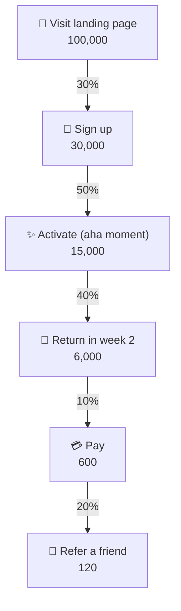

# 🔻 Funnels & conversion (AARRR)

> **In one line:** a funnel is a series of steps users go through. **Conversion rate** is the % who make it from one step to the next.

## Pirate metrics: AARRR

<MetricTree tree={{label: 'AARRR', note: 'by Dave McClure', children: [
  {label: 'Acquisition', note: 'how do people find us?', children: [{label: 'Visitors, CAC, channel mix'}]},
  {label: 'Activation', note: 'do they have a great first experience?', children: [{label: '% reaching the aha moment'}]},
  {label: 'Retention', note: 'do they come back?', children: [{label: 'D1 / D7 / D30 retention'}]},
  {label: 'Revenue', note: 'do they pay?', children: [{label: 'Conversion to paid, ARPU'}]},
  {label: 'Referral', note: 'do they tell others?', children: [{label: 'Invites, viral coefficient'}]},
]}} />

## How to use funnels
1. **Find the biggest leak**: the step with the largest absolute or relative drop.
2. **Segment it**: by device, channel, or new vs returning users.
3. **Fix the leak** with experiments, then move on to the next one.

:::tip Math trick
Improving an early step by 10% raises every later step by 10% too. Improving retention, though, *compounds* over time. That's why it usually matters most.
:::

<Quiz question="Sign-ups 10,000 → activated 2,000 → paid 400. Where's the biggest relative leak?" options={["Sign-up → activated (20%)", "Activated → paid (20%)", "They are equal", "Can't tell"]} answer={2} explain="Both steps convert at 20%, so you'd need segmentation and benchmarks to decide which to work on." />

<UsedBy concept="funnel-conversion" />
