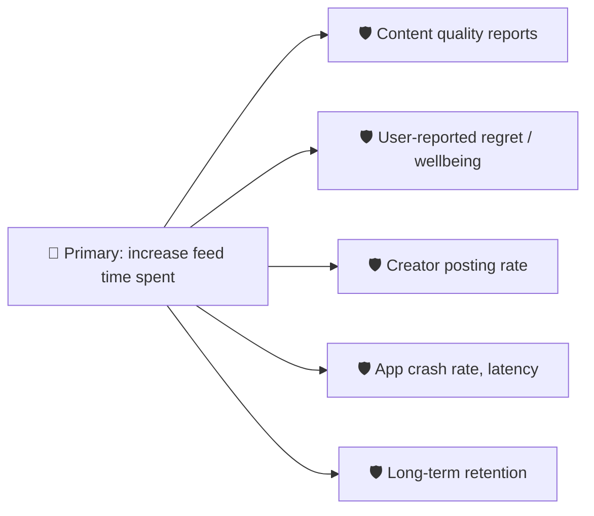

# 🛡️ Guardrail (counter) metrics

> **In one line:** metrics that **must not get worse** while you push your primary metric up. They stop you winning the battle and losing the war.

## Goodhart's law
> "When a measure becomes a target, it ceases to be a good measure."

| If you only optimize… | You might accidentally… | Guardrail |
|---|---|---|
| Click-through rate | Promote clickbait | Dwell time, hide rate |
| Delivery speed | Cause unsafe driving | Accident and incident rate |
| Support tickets closed | Close tickets without solving them | Reopen rate, CSAT |
| Sign-ups | Attract low-intent users | D7 retention of new users |
| Ad revenue | Annoy users | Session length, uninstall rate |

## Types of guardrails
<IconCards items={[
  {icon: '👤', title: 'User experience', text: 'Satisfaction, complaints, uninstalls'},
  {icon: '⚙️', title: 'Technical', text: 'Latency, errors, crashes'},
  {icon: '💰', title: 'Business', text: 'Revenue, cost per order, margins'},
  {icon: '🤝', title: 'Ecosystem', text: 'Other side of a marketplace, trust & safety'},
]} />

:::tip
In every metrics answer, after choosing the primary metric, say: "…and as guardrails I'd watch X and Y, because optimizing the primary metric alone could hurt Z." It's one sentence that signals seniority.
:::

<Quiz question="You're increasing push notifications to raise DAU. The best guardrail is…" options={["Number of notifications sent", "Notification opt-out and uninstall rate", "DAU", "Server cost"]} answer={1} explain="Opt-outs and uninstalls capture the harm that more notifications could cause." />

<UsedBy concept="guardrail-metrics" />
