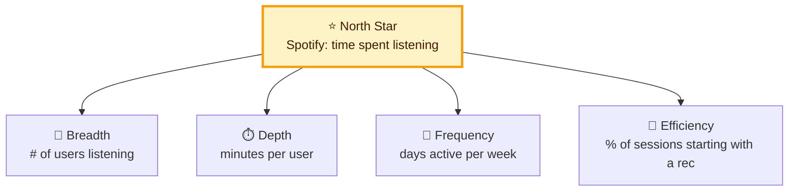
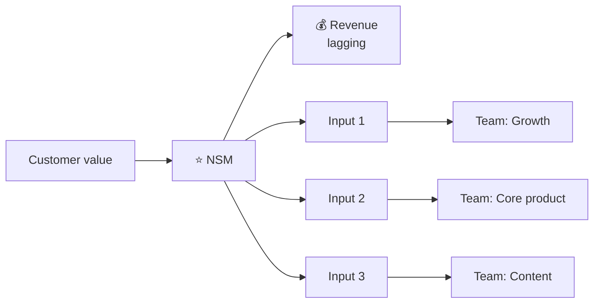

# ⭐ North Star Metric (NSM)

> **In one line:** the single metric that best captures the **value your product delivers to customers**, and that predicts long-term business success.

## A good NSM is…

<IconCards items={[
  {icon: '💎', title: 'Value-based', text: 'Goes up when users get real value, not just when they show up.'},
  {icon: '📈', title: 'Leading', text: 'Predicts revenue and retention later.'},
  {icon: '🎛️', title: 'Actionable', text: 'Teams can influence it through its input metrics.'},
  {icon: '🧮', title: 'Simple', text: 'Anyone in the company understands it.'},
]} />

## Famous examples

| Company | North Star | Why it works |
|---|---|---|
| Airbnb | Nights booked | Value for guest AND host |
| Uber | Completed rides per week | Captures supply, demand and reliability |
| Slack | Messages sent in teams of 3+ people | Shows real team adoption |
| Facebook (early) | Users reaching 7 friends in 10 days | Activation predicts retention |
| Netflix | Hours streamed per member | Engagement drives renewals |
| Duolingo | Daily active learners | Habit equals learning |

## The NSM framework tree

:::warning Common mistakes
- **Revenue as the NSM.** Revenue is an *outcome*. It can go up while value goes down (for example, through price hikes).
- **Vanity metrics** like downloads or registered users.
- No guardrails. See [Guardrail metrics](/docs/concepts/guardrail-metrics).
:::

<Quiz question="Which is the weakest North Star for Airbnb?" options={["Nights booked", "Number of app downloads", "Nights booked with 4+ star reviews", "Repeat bookers"]} answer={1} explain="Downloads say nothing about whether guests or hosts got value." />

<UsedBy concept="north-star-metric" />
