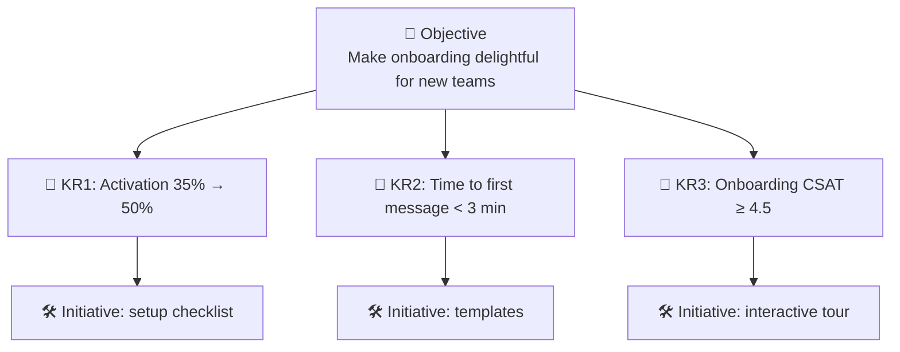
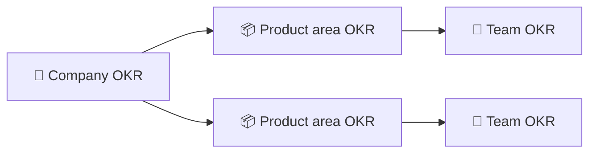

# 🎯 OKRs & goal setting

> **In one line:** an **Objective** says where you want to go (qualitative and inspiring). **Key Results** measure whether you got there (quantitative).

## Good vs bad key results

| ❌ Bad (output / task) | ✅ Good (outcome) |
|---|---|
| Launch the new onboarding flow | Raise 7-day activation from 35% to 50% |
| Send 10 emails per week | Increase reactivation of dormant users by 15% |
| Build an AI search feature | Cut "no results" searches from 12% to 5% |

## The alignment cascade

:::tip Aim high
At Google, hitting about 70% of a stretch OKR is considered success. If you hit 100% every time, your goals are too easy.
:::

<Quiz question="Which is an outcome-based key result?" options={["Ship v2 of search", "Hire 3 engineers", "Increase search success rate from 60% to 75%", "Hold weekly meetings"]} answer={2} explain="It measures the change in user behaviour, not the work done." />

<UsedBy concept="okrs" />
