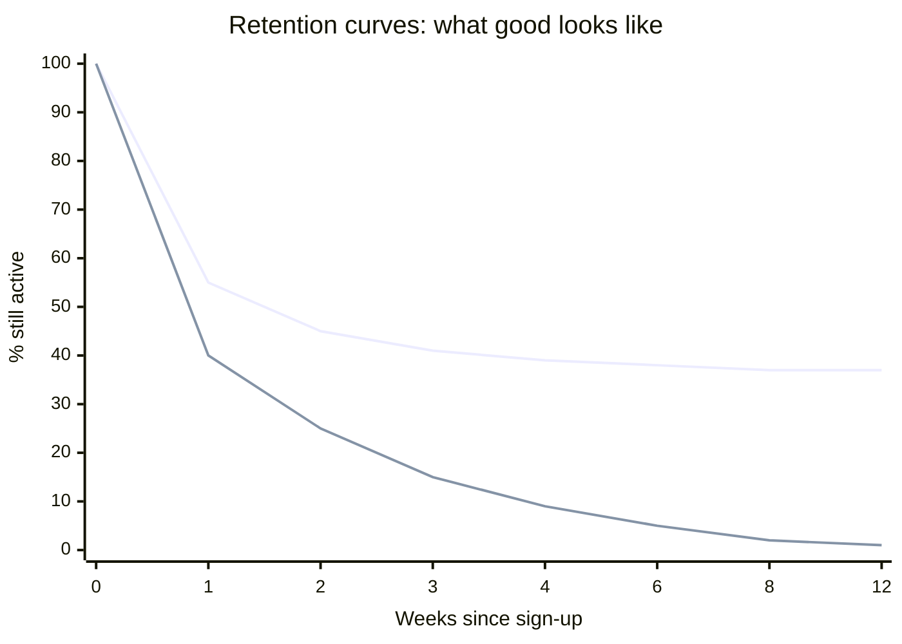
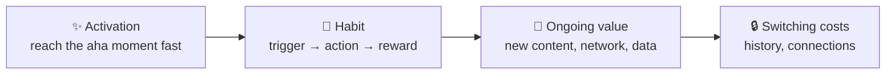

# 🔁 Retention & cohort analysis

> **In one line:** retention is the % of users who come back over time. **Cohorts** group users by when they started, so you can compare them fairly.

**The shape matters more than the number.** A curve that **flattens** means you've found users who get lasting value (a sign of product-market fit). A curve that keeps declining to zero means a leaky bucket.

## Cohort table: read it diagonally and down

| Signup month | M0 | M1 | M2 | M3 |
|---|---|---|---|---|
| Jan | 100% | 42% | 35% | 33% |
| Feb | 100% | 45% | 38% | 36% |
| Mar | 100% | 51% | 44% | — |
| Apr | 100% | 55% | — | — |

Reading **down** a column shows whether newer cohorts retain better (here they do, so the product is improving).

## Types of retention

| Type | Definition | Best for |
|---|---|---|
| N-day | active exactly on day N | daily-habit apps |
| Unbounded (rolling) | active on day N **or later** | infrequent products such as travel |
| Bracket | active in week/month N | weekly products |

## Retention drivers

:::tip Choose the right frequency
Don't judge a tax app by its DAU. Match the retention window to the product's **natural usage frequency**.
:::

<Quiz question="A cohort curve that flattens at 30% after week 4 suggests…" options={["The product is failing", "A core group gets lasting value: a sign of PMF", "Seasonality", "A tracking bug"]} answer={1} explain="Flattening means a stable retained base. The next job is to raise where it flattens." />

<UsedBy concept="retention-cohorts" />
