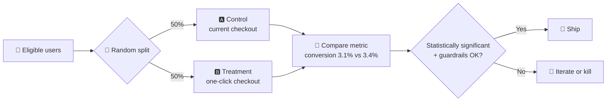

# 🧪 A/B testing (experiments)

> **In one line:** randomly split users into a control (A) and a treatment (B), change one thing, and measure the difference to learn **cause and effect**.

## The experiment design checklist

<FrameworkSteps steps={[
  {letter: '1', title: 'Hypothesis', desc: '“If we add one-click checkout, conversion will rise because there’s less friction.”'},
  {letter: '2', title: 'Metrics', desc: 'One primary metric, secondary metrics and guardrails, all decided BEFORE the test starts.'},
  {letter: '3', title: 'Unit', desc: 'What do you randomize: users, sessions, or cities? Watch out for network effects.'},
  {letter: '4', title: 'Sample size', desc: 'Base it on the baseline rate, the minimum detectable effect (MDE), and the statistical power you need.'},
  {letter: '5', title: 'Duration', desc: 'Run at least 1–2 full weeks to cover weekday and weekend patterns. Don’t stop early.'},
  {letter: '6', title: 'Analyse', desc: 'Check significance, segments and guardrails. Look out for novelty effects.'},
  {letter: '7', title: 'Decide', desc: 'Ship, iterate or kill, and write down what you learned.'},
]} />

## When A/B tests break

| Problem | Example | Fix |
|---|---|---|
| **Network effects / interference** | Marketplace: treatment riders take drivers away from control riders | Randomize by city or time (switchback tests) |
| **Novelty effect** | Users click a shiny new button and then stop | Run longer and look at the trend over time |
| **Peeking** | Stopping as soon as p < 0.05 | Fix the duration up front, or use sequential testing |
| **Too small a sample** | B2B with 200 customers | Qualitative research, staged rollout, or before/after comparison |
| **Long-term effects** | Price change affects churn months later | Holdout groups |

:::tip When NOT to A/B test
Very low traffic, ethically questionable changes, obvious bug fixes, or big strategic bets where the effects only show up over years.
:::

<Quiz question="Uber tests a new pricing algorithm on 50% of riders in the same city. What's the main risk?" options={["Too few users", "Interference: both groups share the same drivers", "Novelty effect", "Seasonality"]} answer={1} explain="Supply is shared across the groups, so treatment changes what control experiences. Randomize by city or time instead." />

<UsedBy concept="ab-testing" />
