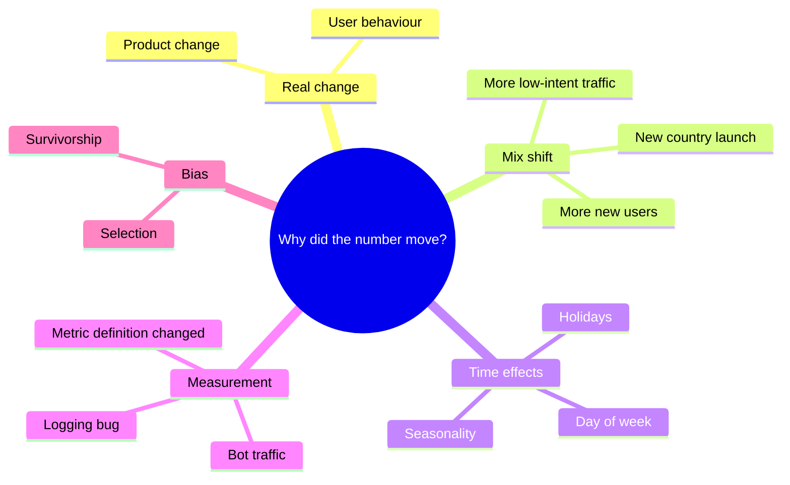

# 🕳️ Data pitfalls every PM should spot

> **In one line:** averages lie. Before trusting a number, check for **mix shift, seasonality, selection bias and tracking changes**.

## Simpson's paradox: a worked example

| Segment | Last month conversion | This month conversion |
|---|---|---|
| Desktop | 10% (on 90k users) | 10% (on 50k users) |
| Mobile | 2% (on 10k users) | 2% (on 50k users) |
| **Total** | **9.2%** | **6.0%** 😱 |

Nothing got worse in **any** segment. The overall rate fell because traffic **shifted toward mobile**, which converts lower. This is called **mix shift**.

## Other classics

| Pitfall | Example |
|---|---|
| **Seasonality** | Ski app usage "crashes" every April |
| **Survivorship bias** | Surveying only current users about why people churn |
| **Selection bias** | Users who opt into a beta are more engaged anyway |
| **Correlation ≠ causation** | Users with dark mode retain better, but dark mode doesn't *cause* retention |
| **Regression to the mean** | Extreme weeks are usually followed by normal ones |
| **Instrumentation change** | A new app version stops firing an analytics event |

:::tip In root-cause questions
Say: "Before diving in, I'd check that the drop is real: no logging or definition change, no bot filtering change. Then I'd check for mix shift by looking at each segment's rate separately."
:::

<Quiz question="Overall conversion dropped, but conversion in every country stayed flat. Most likely?" options={["A checkout bug", "Mix shift toward lower-converting countries", "Competitor launch", "Price increase"]} answer={1} explain="If every segment is flat but the total dropped, the mix of segments changed." />

<UsedBy concept="data-pitfalls" />
