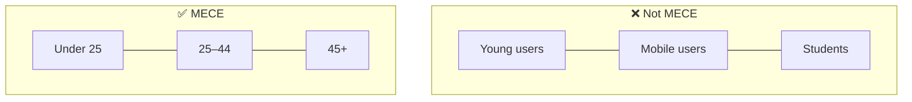

# 🧱 MECE: Mutually Exclusive, Collectively Exhaustive

> **In one line:** split a problem into buckets that **don't overlap** (ME) and **cover everything** (CE).

*"Young", "mobile" and "students" overlap, and they miss older desktop users.*

## Common MECE splits

<IconCards items={[
  {icon: '➕', title: 'Formula', text: 'Revenue = price × quantity; profit = revenue − cost'},
  {icon: '🔁', title: 'Process', text: 'Before / during / after; funnel stages'},
  {icon: '⚖️', title: 'Opposites', text: 'Internal vs external; supply vs demand; new vs existing'},
  {icon: '👥', title: 'Stakeholders', text: 'Buyers, sellers, platform'},
  {icon: '🗺️', title: 'Dimensions', text: 'Geography, platform, time'},
  {icon: '📦', title: '3C / 4P', text: 'Company / customer / competition; product, price, place, promotion'},
]} />

## Why interviewers love it
MECE structure makes your answer **easy to follow** and shows you won't miss a branch. Say your structure first ("I'll look at this from three angles: A, B and C"), then go deep on each one.

<Quiz question="Which split is MECE for 'why are sales down'?" options={["Marketing, mobile, competitors", "Fewer customers OR less spend per customer", "Bad UX, young users, prices", "Weather, bugs"]} answer={1} explain="Sales = customers × spend per customer. These two branches don't overlap and cover everything." />

<UsedBy concept="mece" />
