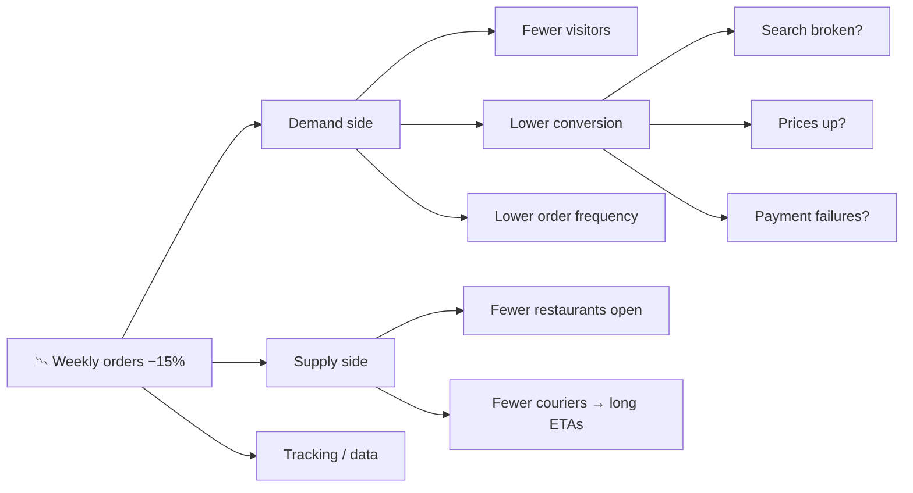
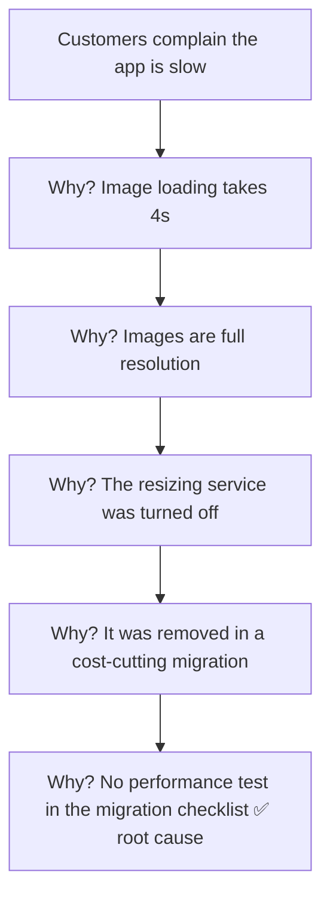

# 🌳 Issue trees, metric decomposition & 5 Whys

> **In one line:** break a big problem into smaller, non-overlapping branches until each one can be tested with data.

## Metric decomposition formulas

| Metric | Decomposition |
|---|---|
| Revenue | users × conversion × orders per buyer × average order value |
| DAU | new + retained + resurrected − churned |
| Ad revenue | users × sessions × ads per session × CTR × CPC |
| Time spent | DAU × sessions per DAU × minutes per session |

## 5 Whys

:::tip
A good tree is **MECE**: each branch is separate, and together they cover every possibility. See [MECE](/docs/concepts/mece).
:::

<Quiz question="DAU = new + retained + resurrected − churned. DAU fell while new users rose. Where to look first?" options={["Acquisition channels", "Retention / churn", "Marketing budget", "Pricing page"]} answer={1} explain="If new users went up but the total went down, churn rose or retention or resurrection fell." />

<UsedBy concept="root-cause-trees" />
