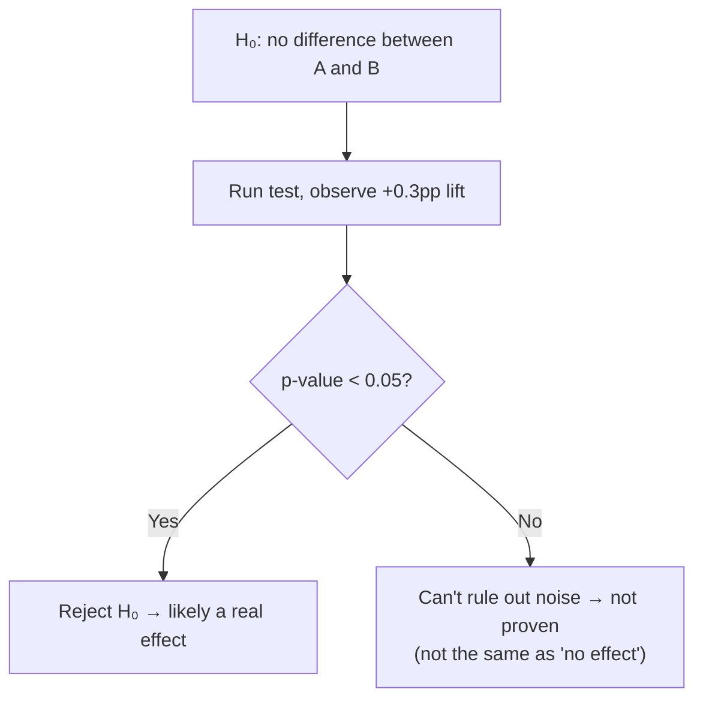
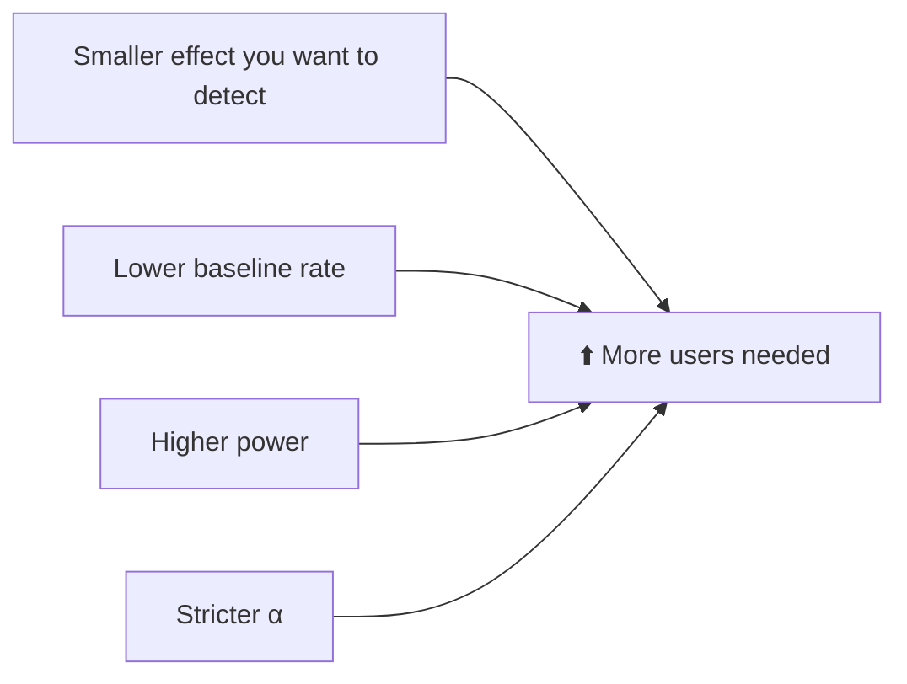

# 📐 Statistical significance, p-values and power

> **In one line:** significance tells you how unlikely your result would be **if there were really no difference**. It's a tool for deciding whether the result is real or just noise.

## The four outcomes

| | Truly no effect | Truly an effect |
|---|---|---|
| **Test says effect** | ❌ False positive (Type I, α ≈ 5%) | ✅ True positive (power, usually 80%) |
| **Test says no effect** | ✅ True negative | ❌ False negative (Type II, β ≈ 20%) |

## Key vocabulary (plain English)

<IconCards items={[
  {icon: '🎲', title: 'p-value', text: 'Chance of seeing a result this extreme if nothing really changed. Smaller means stronger evidence.'},
  {icon: '🎯', title: 'Significance level α', text: 'The false-positive rate you accept, usually 5%.'},
  {icon: '💪', title: 'Power', text: 'Chance of detecting a real effect, usually 80%. Needs enough sample.'},
  {icon: '🔬', title: 'MDE', text: 'Minimum detectable effect: the smallest lift worth detecting. Smaller MDE needs a bigger sample.'},
  {icon: '↔️', title: 'Confidence interval', text: 'Range of plausible true effects, e.g. +0.1 to +0.5 pp.'},
  {icon: '🎣', title: 'Multiple testing', text: 'Test 20 metrics and about 1 will be "significant" by chance.'},
]} />

## Sample size intuition

:::warning Statistical vs practical significance
A +0.01% lift can be "significant" with 100M users and still not be worth the engineering cost. Always ask: **is the effect big enough to matter?**
:::

<Quiz question="p = 0.30 in your A/B test. The right conclusion is…" options={["The feature has no effect", "We don't have enough evidence to say there's an effect", "The feature hurts", "Ship it"]} answer={1} explain="A non-significant result is inconclusive. It doesn't prove there's no effect." />

<UsedBy concept="statistical-significance" />
