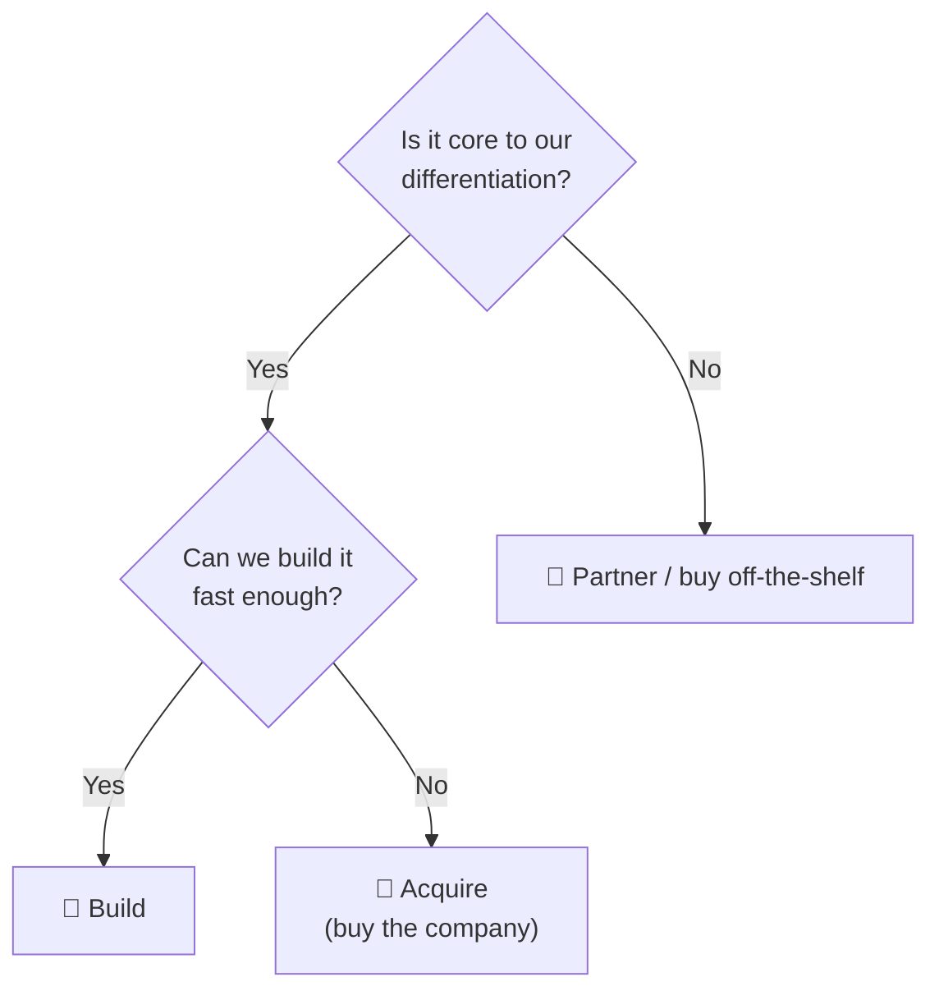

# 🔀 Build vs buy vs partner

> **In one line:** three ways to get a capability. Choose based on **strategic importance, speed, cost and control**.

## Comparison

| | 🔨 Build | 💸 Buy (acquire) | 🤝 Partner |
|---|---|---|---|
| Speed | Slow | Fast | Fastest |
| Cost | Ongoing team cost | High upfront | Revenue share / fees |
| Control | Full | Full (after integration) | Low |
| Risk | Execution risk | Integration and culture risk | Dependency risk |
| Best when | Core differentiator, unique needs | Need speed + talent + users | Non-core, or testing a market |

## Real examples
<IconCards items={[
  {icon: '🔨', title: 'Build', text: 'Apple built its own chips (M1) because performance per watt is core to the Mac.'},
  {icon: '💸', title: 'Buy', text: 'Facebook bought Instagram for $1B to win mobile photos fast.'},
  {icon: '🤝', title: 'Partner', text: 'Uber partnered with Google Maps early on rather than building maps.'},
]} />

<Quiz question="A food delivery app needs payments. Payments aren't a differentiator. Best choice?" options={["Build a payment processor", "Acquire a bank", "Partner with Stripe/Adyen", "Skip payments"]} answer={2} explain="It's non-core and commoditized, so partnering is fastest and cheapest." />

<UsedBy concept="build-buy-partner" />
