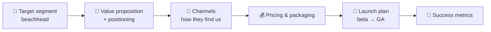
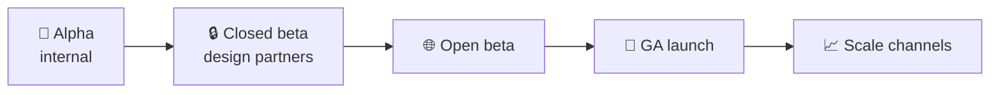

# 🚀 Go-to-market (GTM) strategy

> **In one line:** your plan for **who** you'll sell to first, **what** you'll say, **how** they'll find and buy it, and **how** you'll know it's working.

## Growth motions

| Motion | How it works | Examples |
|---|---|---|
| **Product-led (PLG)** | Users try for free, the product sells itself, viral loops | Slack, Notion, Figma, Zoom |
| **Sales-led** | Sales team, demos, contracts | Salesforce, Workday |
| **Marketing-led** | Content, ads, brand | Consumer apps, D2C |
| **Community-led** | Users help each other and spread the word | Discord, Duolingo, open source |
| **Partner-led** | Distribution through partners | Apps preinstalled on devices |

## Positioning statement template
> For **[target customer]** who **[need]**, **[product]** is a **[category]** that **[key benefit]**. Unlike **[alternative]**, we **[differentiator]**.

## Launch phases

<Quiz question="A new developer tool with a free tier that spreads through teams uses which motion?" options={["Sales-led", "Product-led growth", "Partner-led", "TV marketing"]} answer={1} explain="Free trial, bottom-up adoption and in-product virality are the hallmarks of PLG." />

<UsedBy concept="go-to-market" />
