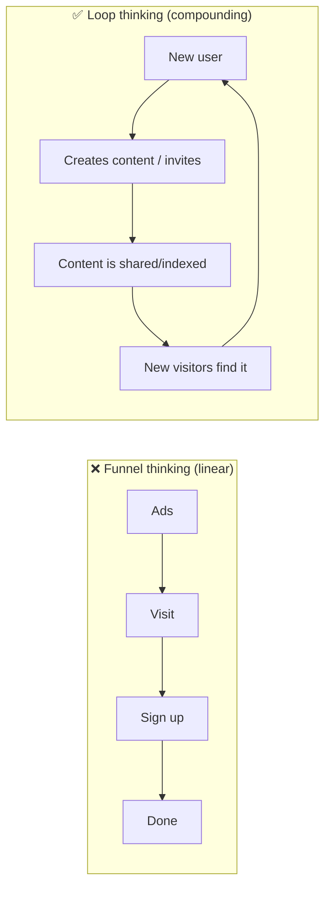
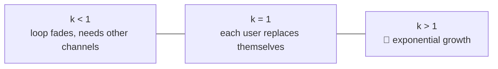

# ♻️ Growth loops & virality

> **In one line:** a growth loop is a closed system where **the output of one cycle becomes the input of the next**, so growth compounds instead of depending on constant spending.

## Common loops

<IconCards items={[
  {icon: '📨', title: 'Viral loop', text: 'User invites friends to collaborate (Dropbox, Zoom, Figma).'},
  {icon: '🔎', title: 'Content / SEO loop', text: 'Users create content that Google indexes and new users find (Pinterest, Quora, Reddit).'},
  {icon: '💸', title: 'Paid loop', text: 'Revenue funds ads, which bring users, who bring revenue. Works only if LTV is greater than CAC.'},
  {icon: '🏪', title: 'Marketplace loop', text: 'More buyers attract more sellers, which brings more selection and more buyers.'},
]} />

## Viral coefficient (k)
**k = invites sent per user × conversion rate of an invite**

Example: each user sends 5 invites and 10% convert, so **k = 0.5**. Every 100 users bring in 50 more, then 25, and so on: 200 users in total. Helpful, but not explosive on its own.

:::tip Cycle time matters too
A loop with k = 0.5 that cycles **daily** beats one with k = 0.7 that cycles **monthly**. Shorten the time from sign-up to first invite.
:::

<Quiz question="Users send 4 invites on average and 20% accept. k = ?" options={["0.2", "0.8", "4", "1.2"]} answer={1} explain="4 × 0.2 = 0.8: valuable, but below 1, so it won't grow on its own." />

<UsedBy concept="growth-loops" />
