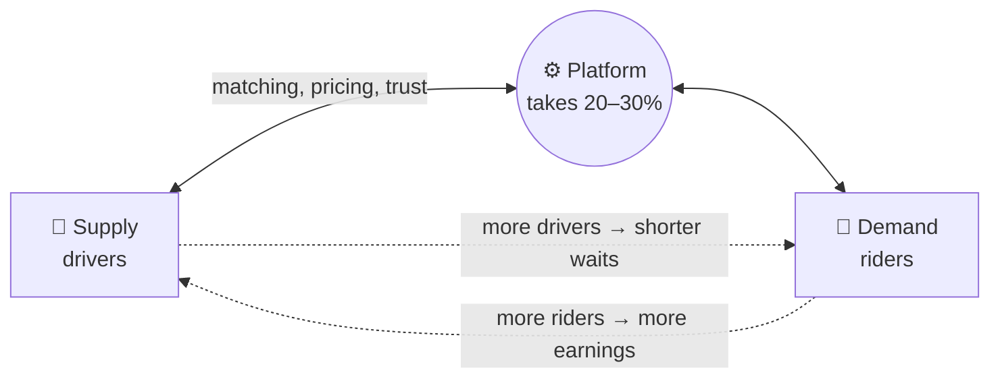
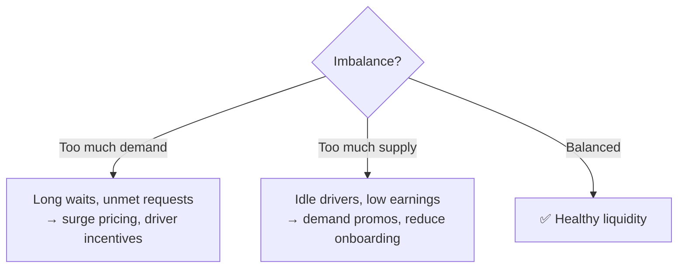

# 🏪 Two-sided marketplaces

> **In one line:** a platform that matches **supply** (sellers, drivers, hosts) with **demand** (buyers, riders, guests) and takes a cut.

## Key marketplace metrics

| Metric | What it tells you |
|---|---|
| **GMV** (gross merchandise value) | Total value transacted |
| **Take rate** | Revenue ÷ GMV |
| **Liquidity** | % of listings that sell, or % of searches that lead to a transaction |
| **Match rate / fill rate** | % of requests fulfilled |
| **Time to match** | e.g. rider ETA |
| **Supply utilization** | % of driver time with a passenger |
| **Repeat rate (both sides)** | Do buyers and sellers come back? |

## Balancing supply and demand

## Always consider both sides
In any marketplace question (metrics, a feature, a root cause), **talk about both sides and the platform**. A feature that delights buyers but hurts sellers will eventually backfire.

:::tip Which side to focus on first?
Usually the **harder-to-acquire** side, which is often supply. It's also the side that determines quality.
:::

<Quiz question="Airbnb bookings are flat but searches are up 20%. What's most likely?" options={["Demand problem", "Liquidity or supply problem: not enough suitable listings", "Pricing too low", "Marketing too weak"]} answer={1} explain="Demand is growing, but searches aren't converting. That points to supply availability or relevance." />

<UsedBy concept="marketplaces" />
