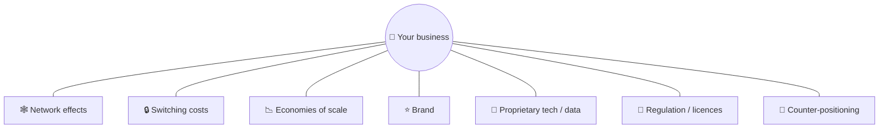

# 🏰 Moats: durable competitive advantage

> **In one line:** a moat is what stops competitors from copying you and taking your customers.

## The seven powers (Hamilton Helmer), simplified

| Moat | Example | How it protects |
|---|---|---|
| Network effects | WhatsApp, LinkedIn | More users = more value |
| Switching costs | Salesforce, iCloud photos | Data and workflows locked in |
| Scale economies | Amazon logistics, Netflix content | Lower cost per unit than rivals |
| Brand | Apple, Coca-Cola | Customers pay more and trust more |
| Cornered resource | Patents, exclusive content | Others can't access it |
| Process power | Toyota production system | Hard-to-copy ways of working |
| Counter-positioning | Vanguard index funds vs active funds | Incumbent can't copy without hurting itself |

:::tip In strategy questions
When recommending a new product, ask: **"What stops Google/Amazon from copying this in 6 months?"** If the answer is "nothing", you need a moat strategy: data, community, integrations, or speed.
:::

<Quiz question="Why is it hard to switch from Slack to a competitor at a large company?" options={["Brand", "Switching costs: integrations, history, habits", "Regulation", "Patents"]} answer={1} explain="Years of messages, integrations and habits make moving costly." />

<UsedBy concept="moats" />
