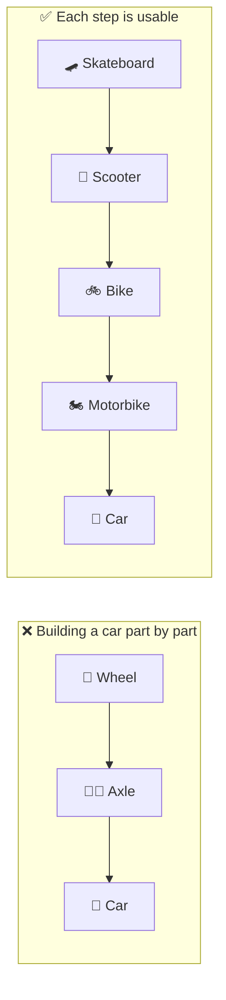
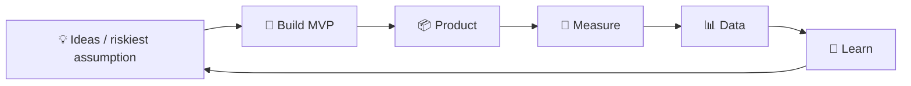

# 🛹 MVP: Minimum Viable Product

> **In one line:** the smallest thing you can build to **learn** whether your riskiest assumption is true.

Each stage solves the core job (getting from A to B) and gives you feedback.

## Build → Measure → Learn

## Types of MVP (cheapest first)

| MVP type | How it works | Example |
|---|---|---|
| **Landing page / fake door** | Describe the product and measure sign-ups | Buffer tested pricing pages before building anything |
| **Concierge** | Do it manually for a few customers | Early Food on the Table planned meals by hand |
| **Wizard of Oz** | Looks automated, but humans work behind the scenes | Zappos founder bought shoes at stores to fill orders |
| **Single feature** | Do one thing extremely well | Early Instagram: photo filters and sharing |
| **Piecemeal** | Glue together existing tools | Groupon started on WordPress with emailed PDFs |

:::tip In design questions
End with: "For the MVP, I'd test the riskiest assumption, which is **___**, using a ___ MVP, and measure ___."
:::

<Quiz question="You're not sure people will pay for AI meal planning. The cheapest MVP is…" options={["Build the full app with ML", "A landing page with pricing and a 'Join waitlist' button", "Hire 10 engineers", "Run a TV campaign"]} answer={1} explain="A fake-door test checks demand and willingness to pay before you build anything." />

<UsedBy concept="mvp" />
