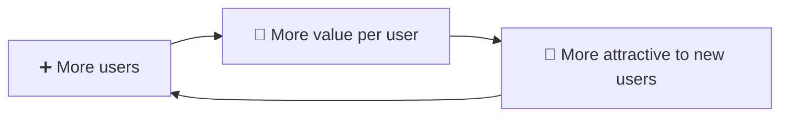
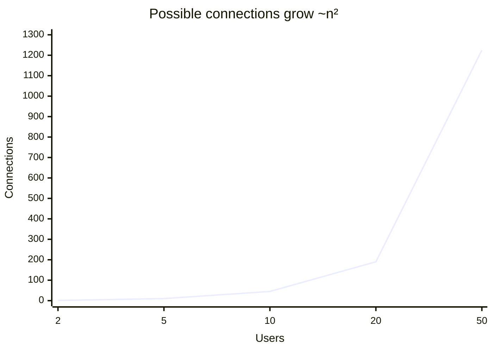

# 🕸️ Network effects

> **In one line:** a product has network effects when **each new user makes it more valuable for every other user**.

## Types

<IconCards items={[
  {icon: '📞', title: 'Direct (same side)', text: 'WhatsApp, the telephone: more users means more people to talk to.', color: '#8b5cf6'},
  {icon: '🔁', title: 'Two-sided (cross-side)', text: 'Uber, Airbnb: more riders attract more drivers, and more drivers attract more riders.', color: '#ec4899'},
  {icon: '🧠', title: 'Data network effects', text: 'Google Maps, Waze: more usage means better data and a better product.', color: '#10b981'},
  {icon: '🧩', title: 'Platform / ecosystem', text: 'iOS, Windows: more users attract more developers, who build more apps.', color: '#f59e0b'},
  {icon: '🗣️', title: 'Social / local', text: 'Nextdoor, local marketplaces: value comes from density in one place.', color: '#0ea5e9'},
]} />

## Value grows faster than users (Metcalfe's law)

## The cold start problem
A network is worthless with zero users. Classic fixes:
- **Start small and dense**: one campus (Facebook at Harvard) or one city (Uber in San Francisco).
- **Single-player mode**: make it useful alone first (Instagram filters, OpenTable's reservation software for restaurants).
- **Subsidize the hard side**: pay drivers guaranteed rates, or seed content yourself.

:::warning Network effects can reverse
When quality drops (spam, bad actors), more users can make the product *worse*. Trust & safety protects the network.
:::

<Quiz question="Why did Facebook launch campus by campus?" options={["Server limits", "To reach network density in each local network before expanding", "Legal reasons", "Marketing budget"]} answer={1} explain="A social network's value depends on your actual friends being on it. Density beats size." />

<UsedBy concept="network-effects" />
