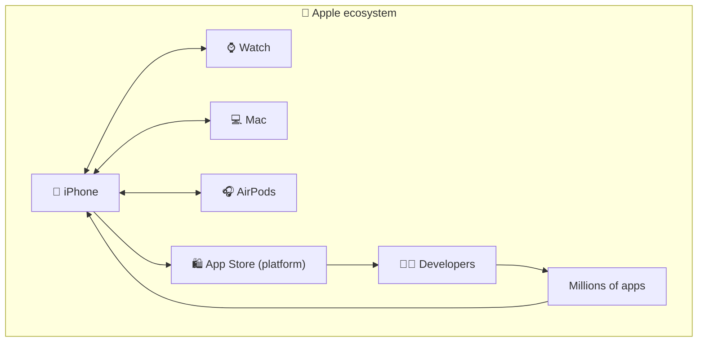
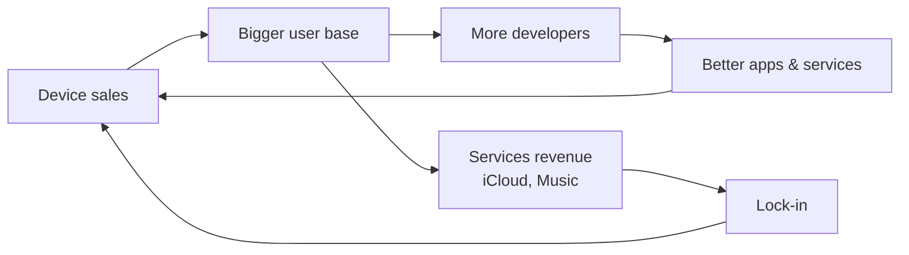

# 🧩 Platforms & ecosystems

> **In one line:** a product solves a problem directly. A **platform** lets *others* build on top of it and create value. An **ecosystem** is the set of connected products that reinforce each other.

## Product vs platform

| | Product | Platform |
|---|---|---|
| Value created by | The company | The company + third parties |
| Growth | Linear | Network effects |
| Example | Early Shopify store builder | Shopify App Store + payments + logistics |
| Key metric | Users, revenue | Third-party developers, apps, platform GMV |
| Hard part | Building features | Governance, APIs, attracting developers |

## Ecosystem flywheel

:::tip In strategy questions
"Should X become a platform?" Ask whether there is a big enough user base to attract builders, whether third parties can create value the company can't, and whether the company can govern quality and avoid competing unfairly with its own developers.
:::

<Quiz question="What makes something a platform rather than a product?" options={["It has an app", "Third parties create value on top of it", "It's expensive", "It uses AI"]} answer={1} explain="Platforms enable others to build and transact." />

<UsedBy concept="platforms-ecosystems" />
