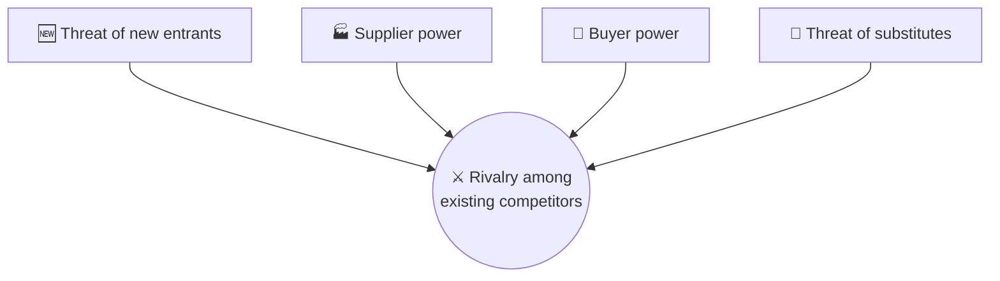

# ⚔️ Porter's five forces

> **In one line:** five forces decide how attractive (profitable) an industry is to enter.

## Quick example: food delivery

| Force | Strength | Why |
|---|---|---|
| New entrants | 🟡 Medium | Apps are easy to build, but logistics and network density are hard |
| Supplier power (restaurants) | 🟡 Medium | Big chains negotiate lower commissions; small restaurants can't |
| Buyer power (customers) | 🔴 High | Zero switching cost, price-sensitive |
| Substitutes | 🔴 High | Cooking, grocery kits, dining out |
| Rivalry | 🔴 High | Discount wars between platforms |

**Conclusion:** structurally tough, low-margin industry. Winners need density, differentiation (subscriptions, exclusives) and operational efficiency.

:::tip
Use Porter in **market entry** questions to judge market attractiveness. Pair it with "ability to win" (the company's strengths) to make a recommendation.
:::

<Quiz question="An industry where customers can switch for free and many substitutes exist has…" options={["High profitability", "Low profitability: strong buyer power and substitutes", "No competition", "High barriers to entry"]} answer={1} explain="Strong buyers and many substitutes push prices and margins down." />

<UsedBy concept="porters-five-forces" />
