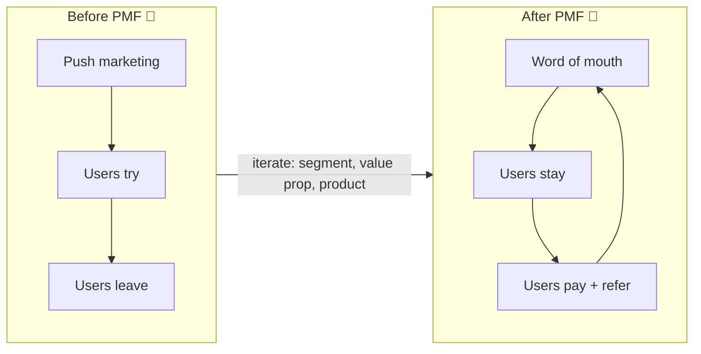
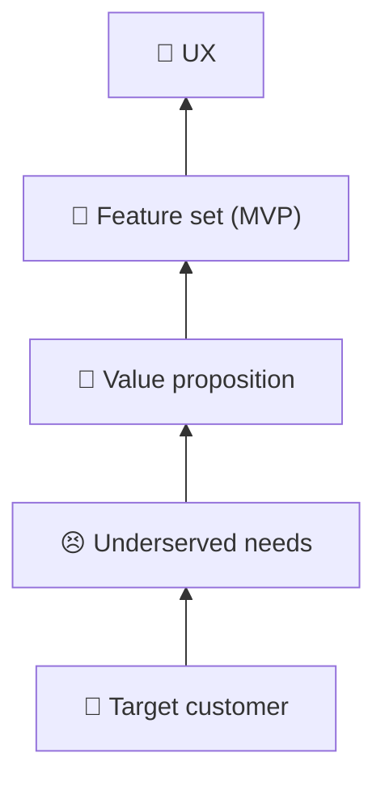

# 🎯 Product-market fit (PMF)

> **In one line:** you have PMF when a specific market **pulls** the product out of your hands. Users stay, pay and tell others without being pushed.

## How to measure PMF

<IconCards items={[
  {icon: '📉', title: 'Flattening retention', text: 'Cohort curves level off instead of dropping to zero.'},
  {icon: '😢', title: 'The 40% test (Sean Ellis)', text: '40% or more of users say they’d be “very disappointed” if the product disappeared.'},
  {icon: '📣', title: 'Organic growth', text: 'A large share of new users come from word of mouth.'},
  {icon: '💳', title: 'Willingness to pay', text: 'Users pay without heavy discounts and renew.'},
]} />

## The PMF pyramid (Dan Olsen)

The bottom two layers are the **problem space** (the market). The top three are the **solution space** (the product). Fit happens when the solution matches the problem.

:::tip In strategy questions
"Before scaling, I'd confirm PMF in one segment: flattening retention plus organic referrals. Scaling acquisition without it just pours water into a leaky bucket."
:::

<Quiz question="Which is the strongest PMF signal?" options={["1M downloads after a TV ad", "Retention curve flattening at 35% with 60% organic sign-ups", "Positive press coverage", "A big funding round"]} answer={1} explain="Stable retention and organic pull show real, lasting value." />

<UsedBy concept="product-market-fit" />
