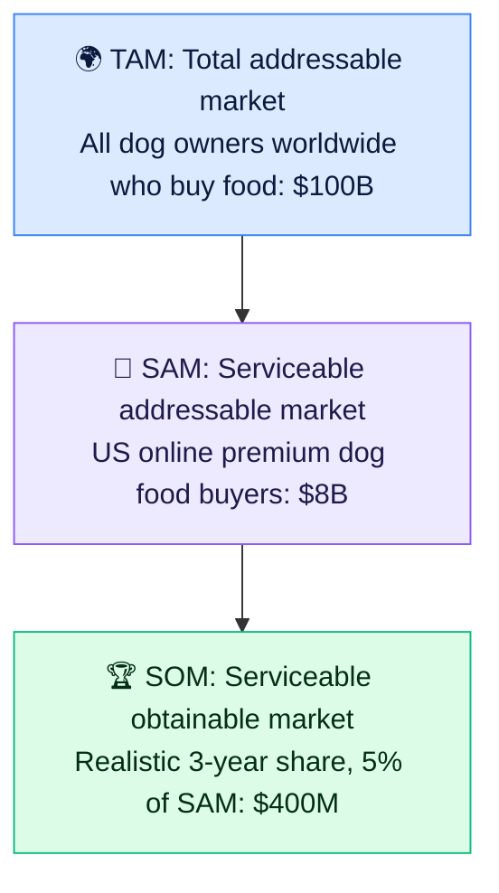

# 🌍 Market sizing: TAM, SAM, SOM

> **In one line:** how big is the opportunity? **TAM** is everyone who could use it, **SAM** is who you can serve, and **SOM** is what you can realistically win.

## Top-down vs bottom-up

| | ⬇️ Top-down | ⬆️ Bottom-up |
|---|---|---|
| Start from | Total population or industry reports | Unit economics: customers × price |
| Example | 130M US households × 38% own dogs × $500/yr | 50k pet stores × 200 customers × $40/mo |
| Pros | Quick | More credible, ties to the business model |
| Cons | Over-optimistic | Needs more assumptions about the business |

:::tip
Investors and interviewers trust **bottom-up** more. Do both if you have time, and check that they land within about 2–3× of each other.
:::

<Quiz question="Your startup can only sell in the US online channel. That market is your…" options={["TAM", "SAM", "SOM", "GMV"]} answer={1} explain="SAM is the part of the TAM your product and channels can actually serve." />

<UsedBy concept="market-sizing" />
