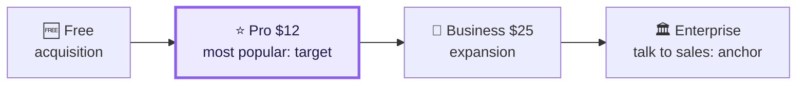

# 🏷️ Pricing models & psychology

> **In one line:** *how* you charge (the model) matters as much as *how much* (the price point).

<IconCards items={[
  {icon: '🔁', title: 'Subscription', text: 'Recurring fee (Netflix, Spotify). Predictable revenue. The main risk is churn.'},
  {icon: '🆓', title: 'Freemium', text: 'Free core, paid premium (Dropbox, Duolingo). Typically 2–5% convert to paid.'},
  {icon: '📶', title: 'Tiered', text: 'Good / better / best (most SaaS). Captures different willingness to pay.'},
  {icon: '⚡', title: 'Usage-based', text: 'Pay per unit (AWS, OpenAI API, Twilio). Scales with value delivered.'},
  {icon: '👥', title: 'Per seat', text: 'Price per user (Slack, Figma). Grows as the team grows.'},
  {icon: '📢', title: 'Ads', text: 'Free for users, advertisers pay (Google, Meta). Needs huge scale.'},
  {icon: '🧾', title: 'Transaction fee', text: 'A cut of each transaction (Stripe, Uber, App Store).'},
  {icon: '💵', title: 'One-time', text: 'Pay once (games, software licences). Revenue only comes from new buyers.'},
]} />

## Pricing psychology toolkit

| Tactic | Example |
|---|---|
| **Anchoring** | Show the $99 Enterprise tier first, so $29 Pro feels cheap |
| **Decoy** | Medium popcorn priced close to large makes large look like a deal |
| **Charm pricing** | $9.99 instead of $10 |
| **Annual discount** | "2 months free" lowers churn and brings cash in early |
| **Free trial vs freemium** | Trial = full features for a limited time; freemium = limited features forever |
| **Value metric** | Charge for what scales with customer value (seats, GB, API calls) |

## Good–better–best

<Quiz question="An AI API's costs scale with tokens processed. Best pricing model?" options={["One-time licence", "Usage-based (per token) with volume tiers", "Ads", "Flat $5/month"]} answer={1} explain="Usage-based pricing keeps price aligned with both cost and value." />

<UsedBy concept="pricing-models" />
