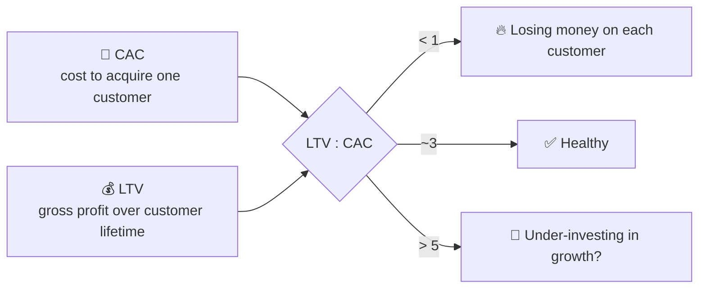
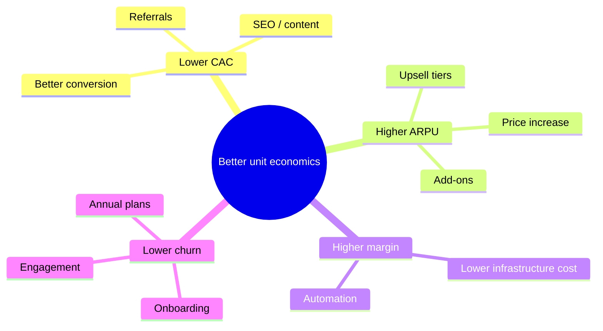

# 🧾 Unit economics: CAC, LTV, payback, margins

> **In one line:** do you make more from a customer than it costs to get and serve them?

## Formulas

| Metric | Formula |
|---|---|
| **CAC** | sales & marketing spend ÷ new customers |
| **ARPU** | revenue ÷ active users (per month) |
| **Gross margin** | (revenue − cost of goods sold) ÷ revenue |
| **Churn (monthly)** | customers lost ÷ customers at the start of the month |
| **LTV** | ARPU × gross margin ÷ monthly churn |
| **Payback period** | CAC ÷ (ARPU × gross margin) months |

## Try it

<EstimationCalc
  inputs={[
    {key: 'arpu', label: 'ARPU per month', value: 20, unit: '$'},
    {key: 'gm', label: 'Gross margin', value: 0.8},
    {key: 'churn', label: 'Monthly churn', value: 0.04},
    {key: 'cac', label: 'CAC', value: 150, unit: '$'},
  ]}
  steps={[
    {key: 'life', label: 'Average lifetime (months)', expr: '1 / churn'},
    {key: 'ltv', label: 'LTV', expr: 'arpu * gm * life'},
    {key: 'pay', label: 'Payback (months)', expr: 'cac / (arpu * gm)'},
    {key: 'ratio', label: '⚖️ LTV : CAC', expr: 'ltv / cac'},
  ]}
/>

## Levers to improve unit economics

<Quiz question="ARPU $10/mo, 100% margin, 5% monthly churn. LTV?" options={["$50", "$100", "$200", "$500"]} answer={2} explain="Lifetime = 1 ÷ 0.05 = 20 months, and 20 × $10 = $200." />

<UsedBy concept="unit-economics" />
