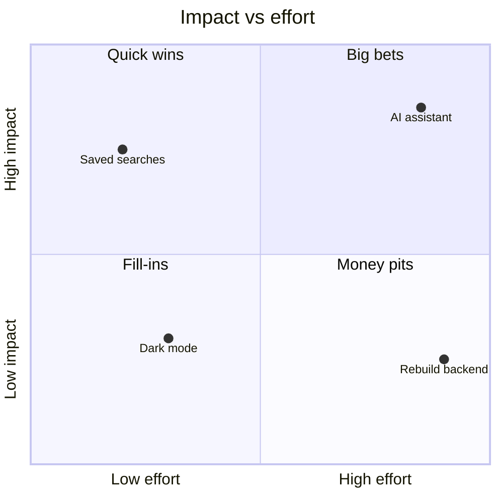
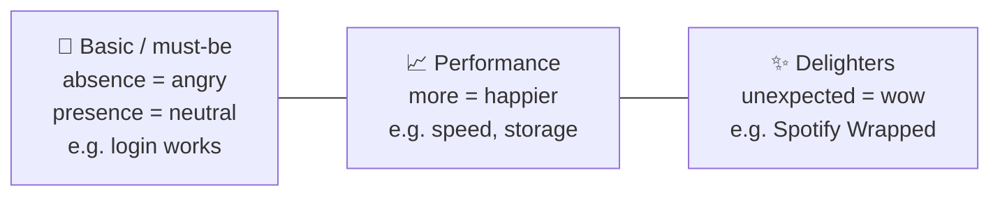

# 🗂️ Prioritization frameworks

> **In one line:** you'll always have more ideas than capacity. A framework makes the trade-offs **explicit and explainable**.

## RICE

**Score = (Reach × Impact × Confidence) ÷ Effort**

<EstimationCalc
  inputs={[
    {key: 'reach', label: 'Reach (users per quarter)', value: 20000},
    {key: 'impact', label: 'Impact (0.25 / 0.5 / 1 / 2 / 3)', value: 2},
    {key: 'conf', label: 'Confidence (0–1)', value: 0.8},
    {key: 'effort', label: 'Effort (person-months)', value: 4},
  ]}
  steps={[
    {key: 'num', label: 'Reach × Impact × Confidence', expr: 'reach * impact * conf'},
    {key: 'rice', label: '🏁 RICE score', expr: 'num / effort'},
  ]}
/>

## Impact vs effort

## Kano model: not all features are equal

Delighters become basics over time. Free shipping used to be a surprise; now it's expected.

## Other tools

| Framework | Best for |
|---|---|
| **MoSCoW** (Must / Should / Could / Won't) | Scoping a release with stakeholders |
| **Cost of delay** | When timing matters (e.g. seasonal deadlines) |
| **Opportunity scoring** | Importance vs current satisfaction gap |
| **Weighted scoring** | Comparing options across several strategic criteria |

:::tip
Frameworks *inform* decisions. They don't make them. Always add judgement: "RICE favours A, but B unblocks our Q3 strategy, so I'd do B first."
:::

<Quiz question="Which feature has the higher RICE score? A: reach 1000, impact 3, confidence 50%, effort 1. B: reach 5000, impact 1, confidence 80%, effort 4." options={["A (1500)", "B (1000)", "Equal", "Can't compute"]} answer={0} explain="A = 1000 × 3 × 0.5 ÷ 1 = 1500. B = 5000 × 1 × 0.8 ÷ 4 = 1000." />

<UsedBy concept="prioritization" />
