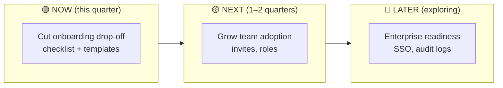
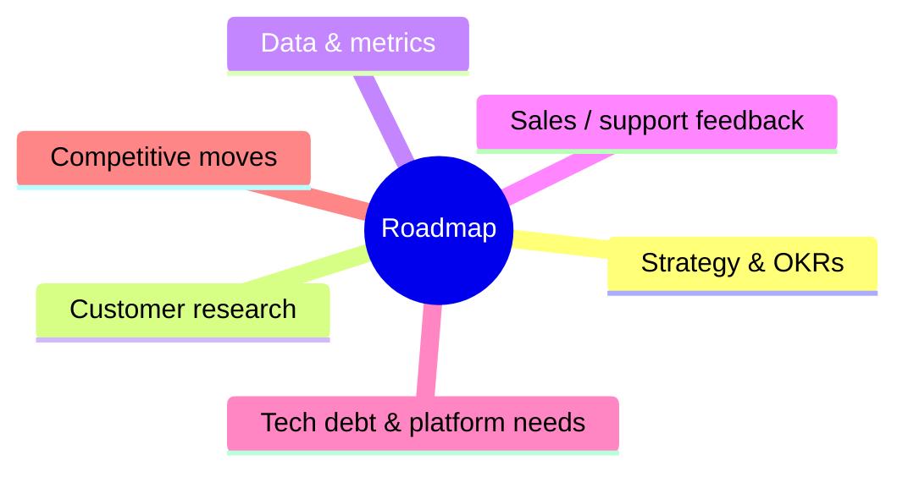

# 🛣️ Roadmaps

> **In one line:** a roadmap communicates **direction and priorities over time**. It's a strategic story, not a promise of delivery dates.

## Now / Next / Later (outcome-based)

Confidence drops the further right you go. That's expected and honest.

## Feature roadmap vs outcome roadmap

| ❌ Feature-based | ✅ Outcome-based |
|---|---|
| Q1: Build dark mode | Q1: Increase evening session length |
| Q2: Ship chat | Q2: Reduce time to resolve buyer questions |
| Fixed dates for everything | Themes + problems + success metrics |

## Inputs to a roadmap

<Quiz question="Why prefer an outcome-based roadmap?" options={["It looks nicer", "It keeps teams focused on solving problems and leaves room to change solutions", "It has more dates", "Executives require it"]} answer={1} explain="Outcomes stay stable while the solutions can evolve as you learn." />

<UsedBy concept="roadmapping" />
