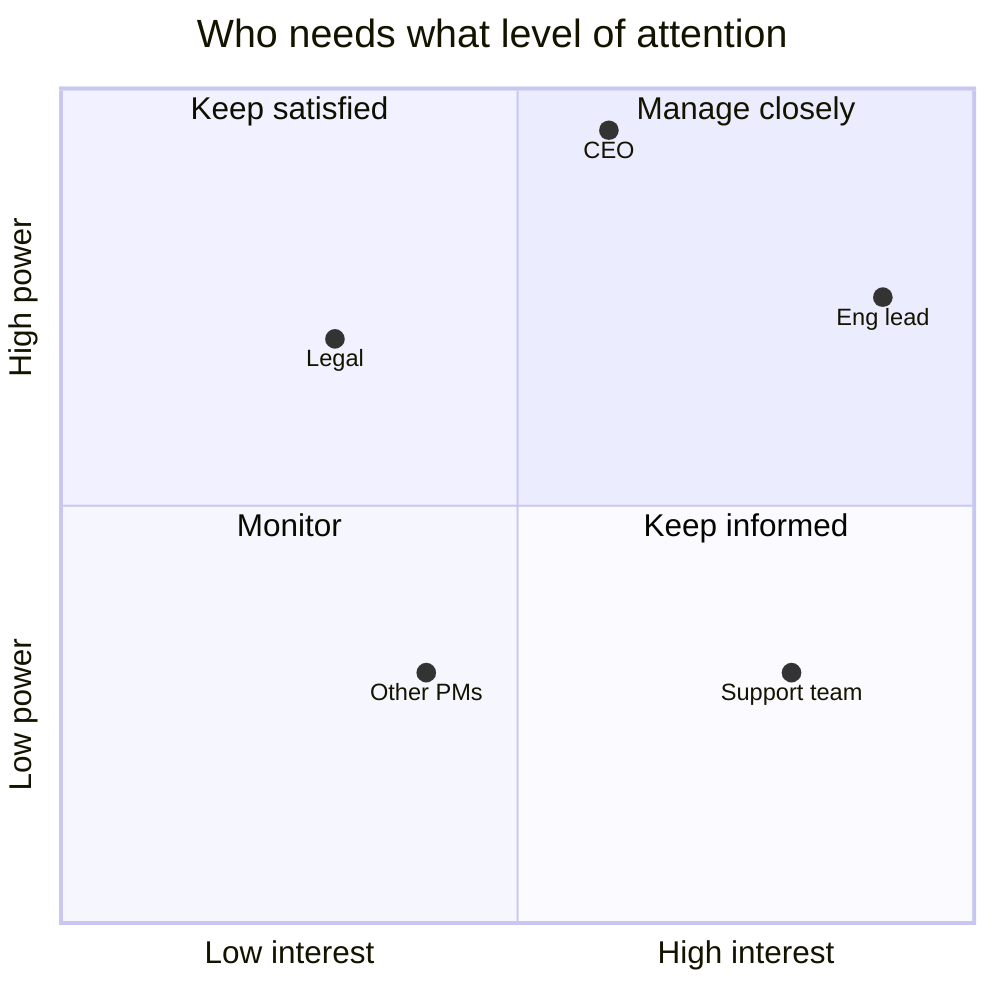

# 🤝 Stakeholder management & influence

> **In one line:** PMs rarely have authority. They lead through **clarity, data, trust and shared goals**.

## Power / interest grid

## Influence without authority

<FrameworkSteps steps={[
  {letter: '1', title: 'Understand', desc: 'What does this stakeholder care about? What are their incentives, fears and goals?'},
  {letter: '2', title: 'Align on goal', desc: 'Find the shared objective, such as the company OKR or the customer outcome.'},
  {letter: '3', title: 'Bring evidence', desc: 'Data, user quotes, experiments. Make it about the customer, not about you.'},
  {letter: '4', title: 'Co-create', desc: 'Invite them to shape the solution. People support what they help build.'},
  {letter: '5', title: 'Disagree & commit', desc: 'Escalate cleanly if needed, then fully support the decision.'},
]} />

## RACI for clarity

| Role | Meaning |
|---|---|
| **R**esponsible | Does the work |
| **A**ccountable | Owns the outcome (only one person) |
| **C**onsulted | Gives input before the decision |
| **I**nformed | Told after the decision |

<Quiz question="Engineering disagrees with your priority. Best first step?" options={["Escalate to your VP", "Understand their concerns and look for the shared goal", "Insist; you're the PM", "Drop the feature"]} answer={1} explain="Understanding their reasons usually uncovers real constraints or a better option." />

<UsedBy concept="stakeholder-management" />
