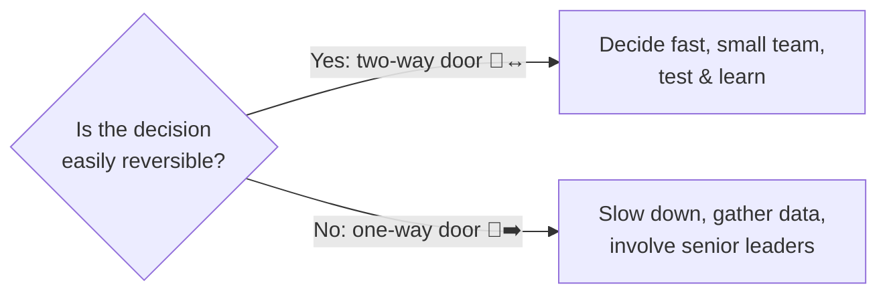

# ⚖️ Trade-offs & decision making under uncertainty

> **In one line:** product work is choosing what **not** to do. Make trade-offs explicit, decide at the right speed, and write down why.

## One-way vs two-way doors (Amazon)

## A trade-off answer template

<FrameworkSteps steps={[
  {letter: '1', title: 'Goal', desc: 'What are we optimizing for right now?'},
  {letter: '2', title: 'Options', desc: 'Lay out the options clearly, including "do nothing".'},
  {letter: '3', title: 'Criteria', desc: 'User impact, business impact, cost, risk, reversibility, strategic fit.'},
  {letter: '4', title: 'Evaluate', desc: 'Score or compare. Be honest about what each option sacrifices.'},
  {letter: '5', title: 'Decide', desc: 'Make a clear recommendation. Name the risk and how you’ll mitigate it.'},
  {letter: '6', title: 'Revisit trigger', desc: 'What signal would make us change our mind?'},
]} />

## Classic PM trade-offs

| Tension | Example question |
|---|---|
| Speed vs quality | Launch now with bugs or delay 2 weeks? |
| Growth vs monetization | Add ads or keep the app ad-free? |
| New users vs power users | Simplify the UI or add advanced features? |
| Short-term vs long-term | Discount promo vs brand value |
| Personalization vs privacy | Use more data for better recommendations? |
| Build vs tech debt | New feature or fix the platform? |

:::tip
Use phrases like: "I'd accept X **in exchange for** Y, because right now Z matters most, and I'd revisit if we see W."
:::

<Quiz question="Changing a button colour is a…" options={["One-way door: escalate", "Two-way door: decide fast and test", "Strategic decision", "Board decision"]} answer={1} explain="It's easily reversible, so decide quickly and learn." />

<UsedBy concept="tradeoffs-decisions" />
