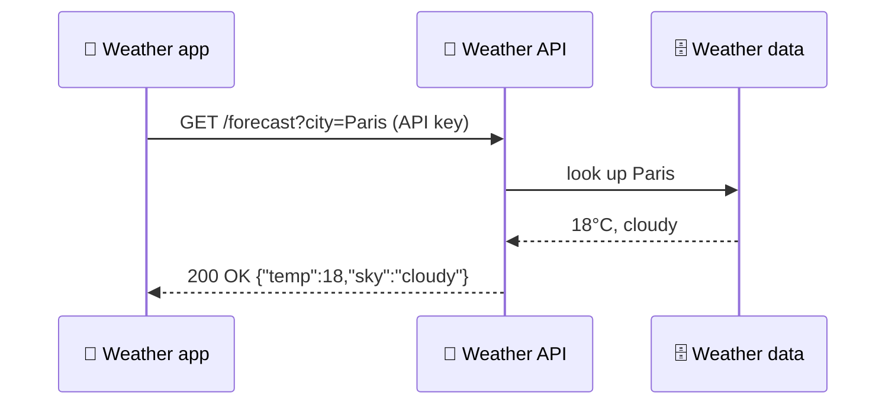
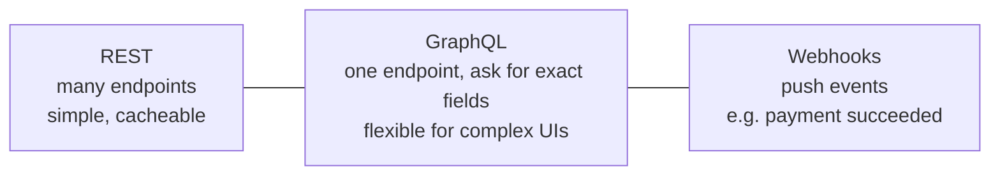

# 🔌 APIs (Application Programming Interfaces)

> **In one line:** an API is a **contract** that lets one piece of software ask another for data or actions, like a restaurant menu between you (the client) and the kitchen (the server).

## Vocabulary

| Term | Plain English |
|---|---|
| **Endpoint** | A specific URL, e.g. `/users/42` |
| **Methods** | GET (read), POST (create), PUT/PATCH (update), DELETE |
| **Status codes** | 200 OK, 400 bad request, 401 unauthorized, 404 not found, 429 too many requests, 500 server error |
| **JSON** | The common text format for data |
| **Auth / API key / OAuth** | Proves who is calling |
| **Rate limit** | Max calls per minute, to protect the server |
| **Webhook** | A "reverse API": the server calls *you* when something happens |
| **SDK** | A library that wraps the API for easier use |

## REST vs GraphQL vs Webhooks

## Why PMs care
- **APIs can be products** (Stripe, Twilio, OpenAI). The "users" are developers, and the key metrics are time to first API call, error rate and latency.
- **Partner integrations** drive retention because they raise switching costs.
- **Versioning**: breaking changes hurt partners, so plan deprecations carefully.

<Quiz question="A partner gets status 429 from your API. What happened?" options={["Server crashed", "They exceeded the rate limit", "Wrong password", "Endpoint missing"]} answer={1} explain="429 means Too Many Requests: rate limiting." />

<UsedBy concept="apis" />
