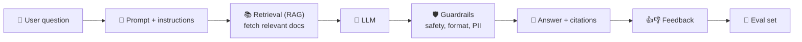
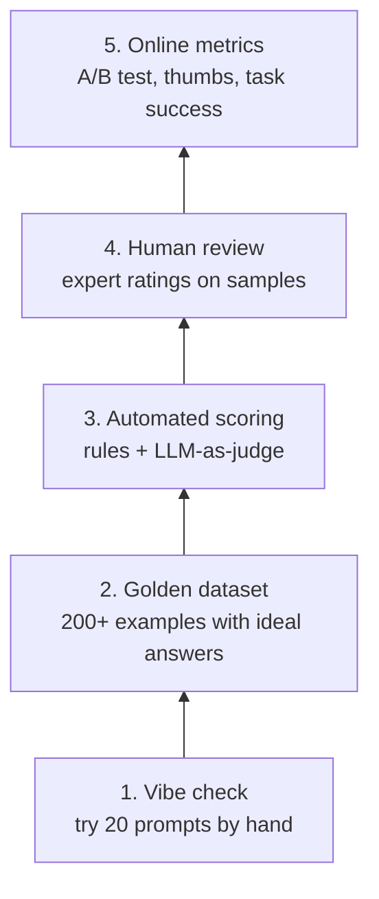

# 💬 LLM products & evaluation

> **In one line:** LLMs are powerful but **probabilistic**. The PM's job is to build an evaluation system that tells you whether the product is getting better.

## Anatomy of an LLM feature

## Eval ladder

## What to measure

| Dimension | Example metric |
|---|---|
| **Helpfulness / task success** | % of conversations resolved without a human |
| **Accuracy / groundedness** | % of claims supported by sources (hallucination rate) |
| **Safety** | Policy violation rate, jailbreak success rate |
| **Latency** | Time to first token, total response time |
| **Cost** | $ per conversation |
| **User signals** | Thumbs-up rate, retries, copy or accept rate |

## Key terms
- **Hallucination**: a confident but false output.
- **RAG**: retrieval-augmented generation, which gives the model fresh, trusted documents to answer from.
- **Fine-tuning**: further training on your own data for style or specialised tasks.
- **Context window**: how much text the model can consider at once.
- **Agents**: LLMs that take actions using tools (search, code, APIs).

:::tip
"How would you measure an AI assistant?" Answer in layers: **offline evals** (quality before launch), **online metrics** (behaviour after launch), and **guardrails** (safety, cost and latency budgets).
:::

<Quiz question="Your support chatbot invents refund policies. Best first fix?" options={["Bigger model", "RAG over the actual policy docs plus a groundedness eval", "More marketing", "Remove citations"]} answer={1} explain="Grounding answers in real documents, and measuring that, directly attacks hallucination." />

<UsedBy concept="llm-evals" />
