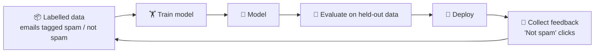
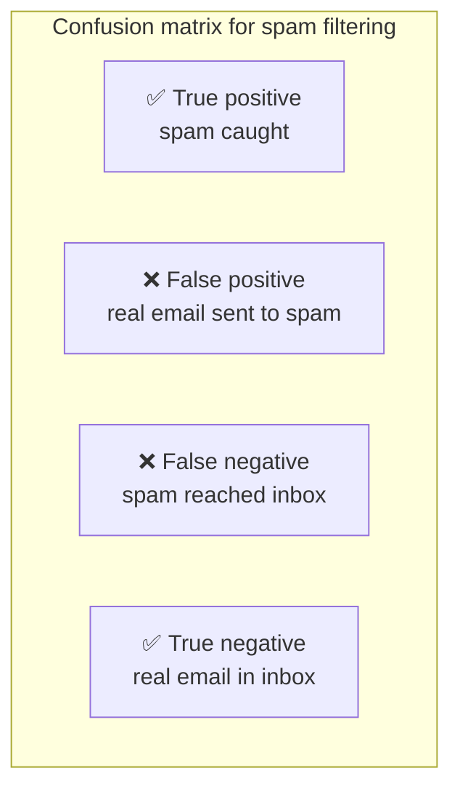

# 🧠 Machine learning basics for PMs

> **In one line:** ML learns patterns from examples (data) instead of hand-written rules. Your job is to define the problem, the data, the quality bar, and the user experience when it's wrong.

## Precision vs recall: the most important trade-off

| Metric | Formula | Question it answers |
|---|---|---|
| **Precision** | TP ÷ (TP + FP) | Of what we flagged, how much was right? |
| **Recall** | TP ÷ (TP + FN) | Of all the real cases, how many did we catch? |
| **F1** | harmonic mean of the two | Balance of both |

**Raising the threshold** makes the model more cautious: precision goes up, recall goes down. Pick based on **which mistake costs more**:
- Spam filter: false positives (missing an important email) are worse, so favour precision.
- Cancer screening: false negatives (missed cancer) are worse, so favour recall.

## Types of ML

| Type | What it does | Example |
|---|---|---|
| Classification | Assign a category | Fraud or not |
| Regression | Predict a number | Delivery ETA |
| Ranking / recommendation | Order items | Feed, search results |
| Clustering | Find groups | User segments |
| Generative | Create content | LLMs, image generation |

<Quiz question="A fraud model blocks many legitimate payments. Which metric is too low?" options={["Recall", "Precision", "Latency", "Coverage"]} answer={1} explain="Many false positives means low precision." />

<UsedBy concept="ml-basics" />
