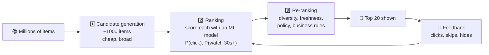

# 🎯 Recommendation systems

> **In one line:** predict which items a user will value most and rank them. This is what powers feeds, "you may also like", and autoplay.

## Two classic approaches

<IconCards items={[
  {icon: '👯', title: 'Collaborative filtering', text: '“Users like you also liked…” Uses behaviour patterns. Struggles with new items (cold start).'},
  {icon: '🏷️', title: 'Content-based', text: '“Because you watched sci-fi…” Uses item features. Can trap users in a bubble.'},
  {icon: '🧬', title: 'Hybrid / deep learning', text: 'Combines both, plus context like time of day and device. What modern systems use.'},
]} />

## Challenges PMs own

| Challenge | Example | Mitigation |
|---|---|---|
| Cold start | New user or new item has no data | Onboarding preferences, popular items, exploration |
| Filter bubble | Only one genre shown | Diversity in re-ranking |
| Clickbait optimization | CTR up, satisfaction down | Optimize long-term signals (watch time, surveys) |
| Feedback loops | Popular gets more popular | Exploration traffic, boosts for new creators |
| Explainability | "Why am I seeing this?" | Show the reason ("Because you liked…") |

<Quiz question="A new song has zero plays. Which approach can still recommend it?" options={["Collaborative filtering", "Content-based (audio and genre features)", "Neither", "Random"]} answer={1} explain="Content features exist before any user has interacted with the item." />

<UsedBy concept="recommendation-systems" />
