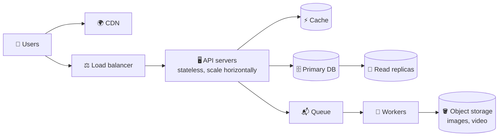

# 🏗️ System design basics for PMs

> **In one line:** know the building blocks (client, server, database, cache, queue, CDN) and the trade-offs between **latency, consistency, cost and scale**.

## Building blocks

<IconCards items={[
  {icon: '⚡', title: 'Cache', text: 'Keeps frequent data in memory. Makes things much faster, but data can be slightly stale.'},
  {icon: '🌍', title: 'CDN', text: 'Copies static files (images, video) to servers near users worldwide.'},
  {icon: '⚖️', title: 'Load balancer', text: 'Spreads traffic across servers and survives one server dying.'},
  {icon: '📬', title: 'Queue', text: 'Handles slow work later (emails, video encoding) so users don’t wait.'},
  {icon: '🗄️', title: 'SQL vs NoSQL', text: 'SQL: structured, consistent (payments). NoSQL: flexible, huge scale (feeds, logs).'},
  {icon: '🔀', title: 'Sharding', text: 'Splits a database across machines when one machine is no longer enough.'},
]} />

## Latency numbers to know (approximate)

| Operation | Time |
|---|---|
| Read from memory (cache) | ~0.1 ms |
| Read from SSD/database | ~1–10 ms |
| Round trip within a region | ~1 ms |
| Round trip US ↔ Europe | ~80–100 ms |
| Users notice delay | > 100 ms |
| Users abandon pages | > 3 s |

## The big trade-off: consistency vs availability
A like counter can be eventually consistent (it's fine if it's off by a few for a second). A bank transfer must be strongly consistent.

<Quiz question="Your feed loads slowly because it hits the database every time. Simplest fix?" options={["Rewrite in another language", "Add a cache for popular feed data", "Buy a bigger monitor", "Remove the feed"]} answer={1} explain="Caching reads that repeat is the classic first fix for latency." />

<UsedBy concept="system-design-basics" />
