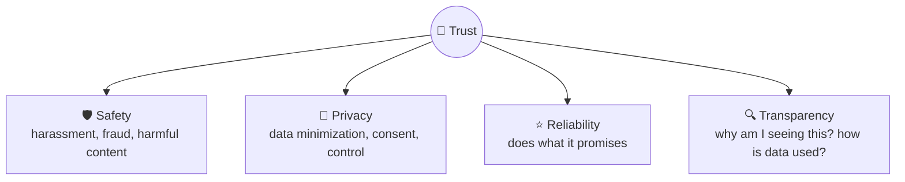
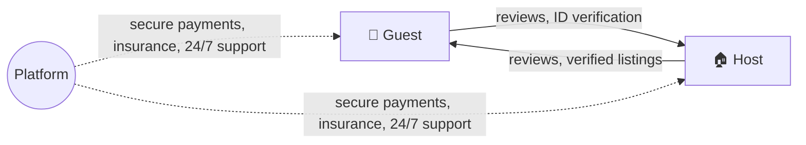

# 🔐 Trust, safety & privacy

> **In one line:** users only engage when they feel safe. Trust is hard to win and easy to lose, so it must be designed in from the start.

## Trust & safety toolkit

| Layer | Examples |
|---|---|
| **Prevent** | Identity verification, rate limits, friction for new accounts |
| **Detect** | ML classifiers, user reports, anomaly detection |
| **Respond** | Remove content, suspend accounts, appeals process |
| **Communicate** | Community guidelines, transparency reports |

## Two-sided trust (marketplaces)

## Privacy principles
- **Data minimization**: collect only what you need.
- **Consent & control**: clear opt-in, easy deletion and export (GDPR, CCPA).
- **Privacy by design**: use on-device processing and anonymization where possible.

:::tip Metrics
Prevalence of harmful content (views of violating content per 10k views), time to action, false positive rate (wrongly removed content), and appeal overturn rate.
:::

<Quiz question="A dating app sees rising harassment reports. Which metric best tracks the problem?" options={["Total sign-ups", "Harassment reports per 1,000 conversations", "DAU", "Revenue"]} answer={1} explain="A normalized prevalence rate shows whether the problem is growing relative to usage." />

<UsedBy concept="trust-safety" />
