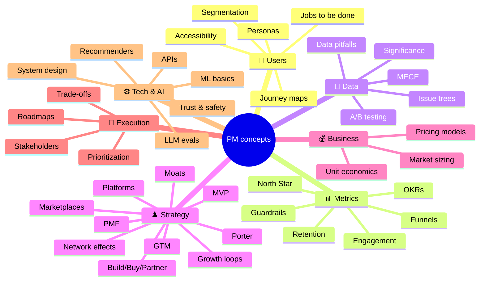

# 💡 Concepts: one idea per chapter

Each chapter teaches **one concept** in about 5 minutes, with a diagram, an example, a quiz, and the list of questions that use it. Open a chapter whenever a question's 💡 chip shows up and you aren't confident.

:::tip
Every concept page ends with **"Questions that use this concept"**. After reading the chapter, practise one of those questions straight away. That's how the concept sticks.
:::
