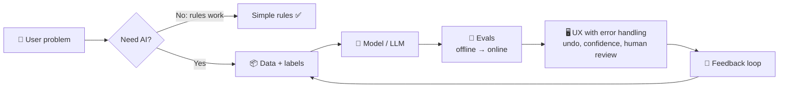
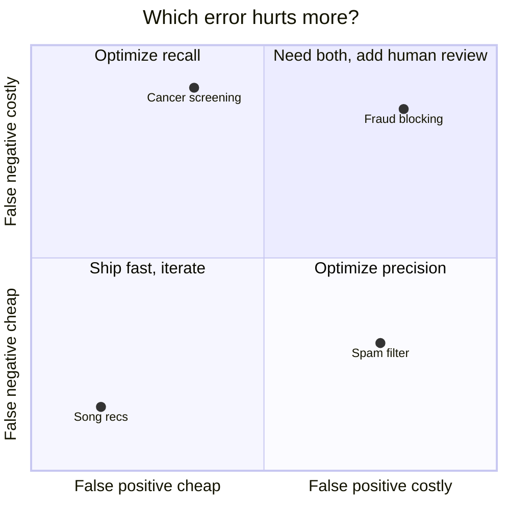

# 🤖 AI / ML product framework

AI product questions add three twists to normal product sense: **is AI even the right tool, how good does the model need to be, and what happens when it's wrong?**

<FrameworkSteps steps={[
  {letter: '1', title: 'Problem first', desc: 'What is the user problem? Would a non-AI solution work just as well?'},
  {letter: '2', title: 'Why AI', desc: 'Is the task about patterns, language, personalization or scale that rules can’t handle?'},
  {letter: '3', title: 'Data', desc: 'What data do you need? Do you have it? What about labels, privacy and the feedback loop?'},
  {letter: '4', title: 'Quality bar', desc: 'Define "good enough": precision vs recall, latency, cost per call.'},
  {letter: '5', title: 'UX for errors', desc: 'How do users understand, correct and trust the output? Keep a human in the loop where needed.'},
  {letter: '6', title: 'Evaluate', desc: 'Offline evals, then online A/B tests, then ongoing monitoring for drift.'},
  {letter: '7', title: 'Risks', desc: 'Bias, hallucination, safety, abuse, regulation and cost blowups.'},
]} />

## Cost of mistakes decides your metric

<UsedBy framework="ai-product" />
