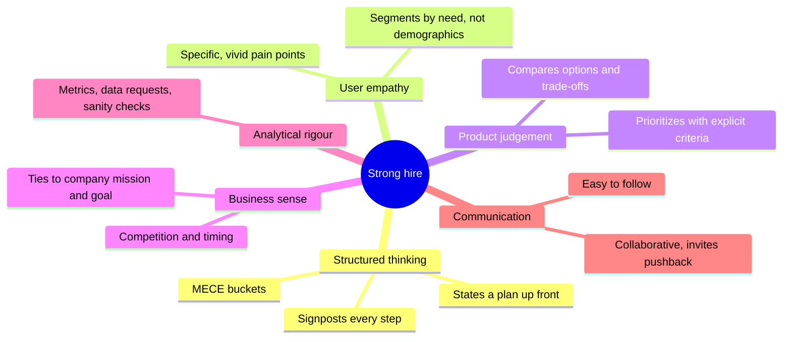
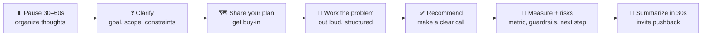

# 🏆 How great answers sound: what "Strong hire" looks like

Every question in this book has a **full mock interview transcript**. This page explains the patterns those transcripts follow. They come from the most widely used PM interview prep sources: *Cracking the PM Interview* (McDowell & Bavaro), *Decode and Conquer* (Lewis Lin, the origin of CIRCLES), Lenny's Newsletter guide to product sense, and the Exponent rubrics. I've paraphrased and combined them here rather than quoting.

## 🎯 What interviewers actually score

No company publishes its official rubric, but prep guides converge on the same five or six dimensions. You usually need a **solid score on every dimension**, not perfection on one.

| Dimension | ❌ No hire sounds like… | ✅ Strong hire sounds like… |
|---|---|---|
| **Structure** | Jumps into ideas, wanders | "Here's my plan: goal, users, pains, solutions, metrics. Sound good?" |
| **Users** | "Users want it to be easier" | "Recently blind adults with no coping systems yet, because they're underserved and growing" |
| **Prioritization** | Lists 8 features | "Three options. I'll score them on impact for this segment, effort, and risk. B wins because…" |
| **Business** | "We could add AI to personalize it" | "This supports the company's goal X, and competitor Y can't easily copy it because…" |
| **Metrics** | "Track engagement" | "North Star: 6-month roommate stays. Guardrail: scam reports per 1,000 matches" |
| **Communication** | Monologue for 15 minutes | Checks in at each step, summarizes, adapts to hints |

## 🔁 The universal answer arc

## 🗣️ Ten habits that run through every transcript

<IconCards items={[
  {icon: '⏸️', title: '1. Ask for a moment', text: '“Mind if I take 30 seconds to structure my thoughts?” Everyone says yes, and it prevents rambling.'},
  {icon: '❓', title: '2. Clarify with purpose', text: 'Ask 3–5 questions that change your answer (goal, user, constraints). Skip trivia. If they say “up to you”, state an assumption.'},
  {icon: '🗺️', title: '3. Signpost', text: 'Announce your structure, then say where you are: “Now that we have the user, let’s look at their pains.”'},
  {icon: '🎯', title: '4. Anchor on a goal', text: 'Every later choice (segment, pain, solution, metric) is justified by the goal you set at the start.'},
  {icon: '👥', title: '5. Pick ONE segment', text: 'List 3–4, choose one using explicit criteria (size, pain, fit), and name what you’re giving up.'},
  {icon: '🎬', title: '6. Tell a story', text: 'Walk through a day in the user’s life. Pain points found in a journey are believable.'},
  {icon: '🌈', title: '7. Range, then focus', text: 'Brainstorm 3+ options including one bold one, then compare them in a small table.'},
  {icon: '⚖️', title: '8. Make the call', text: '“I recommend B.” Then name the trade-off you are accepting. Fence-sitting fails.'},
  {icon: '📏', title: '9. Close with numbers', text: 'Success metric, guardrail, MVP scope, and the first experiment.'},
  {icon: '🤝', title: '10. Treat it as a conversation', text: 'Check in (“Would you like me to go deeper on X?”) and take hints gracefully. Interviewers often steer you on purpose.'},
]} />

## ⏱️ Timing for a 35–45 minute case

```mermaid
gantt
  dateFormat  m
  axisFormat  %M min
  section Product sense
  Pause + clarify            :0, 5
  Goal + users + segment     :5, 6
  Journey + pains + priority :11, 7
  Solutions + trade-offs     :18, 9
  Recommendation + MVP       :27, 4
  Metrics + risks + summary  :31, 5
  Follow-up questions        :36, 8
```

## 🧩 Category-specific "must dos"

| Category | The move that separates great from good |
|---|---|
| 🎨 Design / 🛠️ Improvement | Explain *why the current product works* (or what job it does) before changing anything |
| ♟️ Strategy | End with a clear recommendation, the first 3 steps, and **kill criteria** |
| 📊 Metrics | One North Star with justification, plus guardrails, plus how it could be gamed |
| 🔍 Root cause | Ask for data like an analyst: "Can I see this split by platform?" Then narrow down step by step |
| 🧮 Estimation | Write the formula first, round aggressively, sanity-check with a second method |
| 🤝 Behavioral | 60% of the time on **your** actions. Numbers in the result. A lesson you have applied since |
| ⚙️ Technical | Explain simply, then add the product implication ("…which is why page speed affects conversion") |
| 💰 Pricing | Value metric first, then floor (cost) vs ceiling (value), then test |
| 🤖 AI | Is AI needed? Then the quality bar, what happens when it's wrong, evals, and cost per query |

## 🚩 Red flags that sink otherwise good answers

:::danger Avoid these
- **Solution in the first minute.** "I'd build an app that…" before knowing the goal or the user.
- **"Users" with no segment.** Designing for everyone means designing for no one.
- **Feature lists without priorities.** Energetic, but signals weak judgement.
- **Never making a call.** "It depends" with no conclusion.
- **Ignoring the interviewer's hints.** They redirect you on purpose. Follow them.
- **Forcing a memorized framework** where it doesn't fit. Frameworks are scaffolding, not a script.
- **No metrics.** Every answer should end with how you'd know it worked.
:::

## 📚 Further reading (recommended books and guides)

| Resource | Best for |
|---|---|
| *Cracking the PM Interview*: Gayle Laakmann McDowell & Jackie Bavaro | Whole process, résumé, behavioral, estimation |
| *Decode and Conquer*: Lewis C. Lin | CIRCLES (design), AARM and other metrics frameworks |
| *The Product Manager Interview*: Lewis C. Lin | Large bank of practice questions with sample answers |
| *Inspired* and *Empowered*: Marty Cagan | Real product thinking, discovery, outcome-driven teams |
| *Lean Analytics*: Croll & Yoskovitz | Choosing the right metric for each business type |
| Lenny's Newsletter: "The definitive guide to mastering product sense interviews" | Product sense dimensions and worked examples |
| Exponent product sense and analytical rubrics (tryexponent.com) | What separates No hire, Hire and Strong hire |
