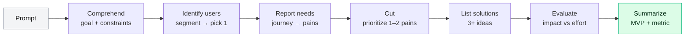
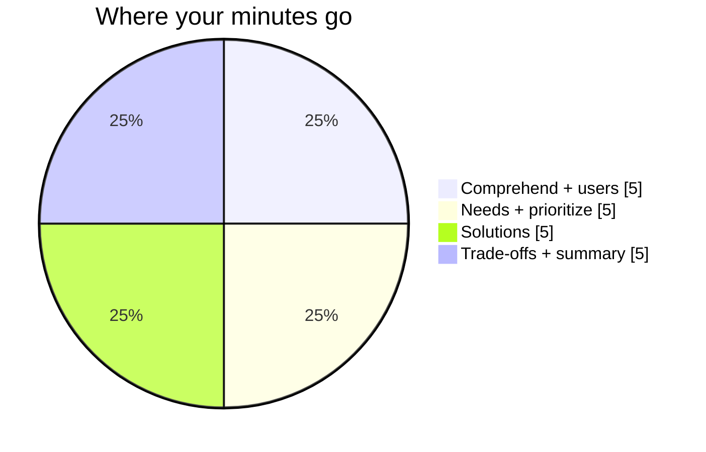
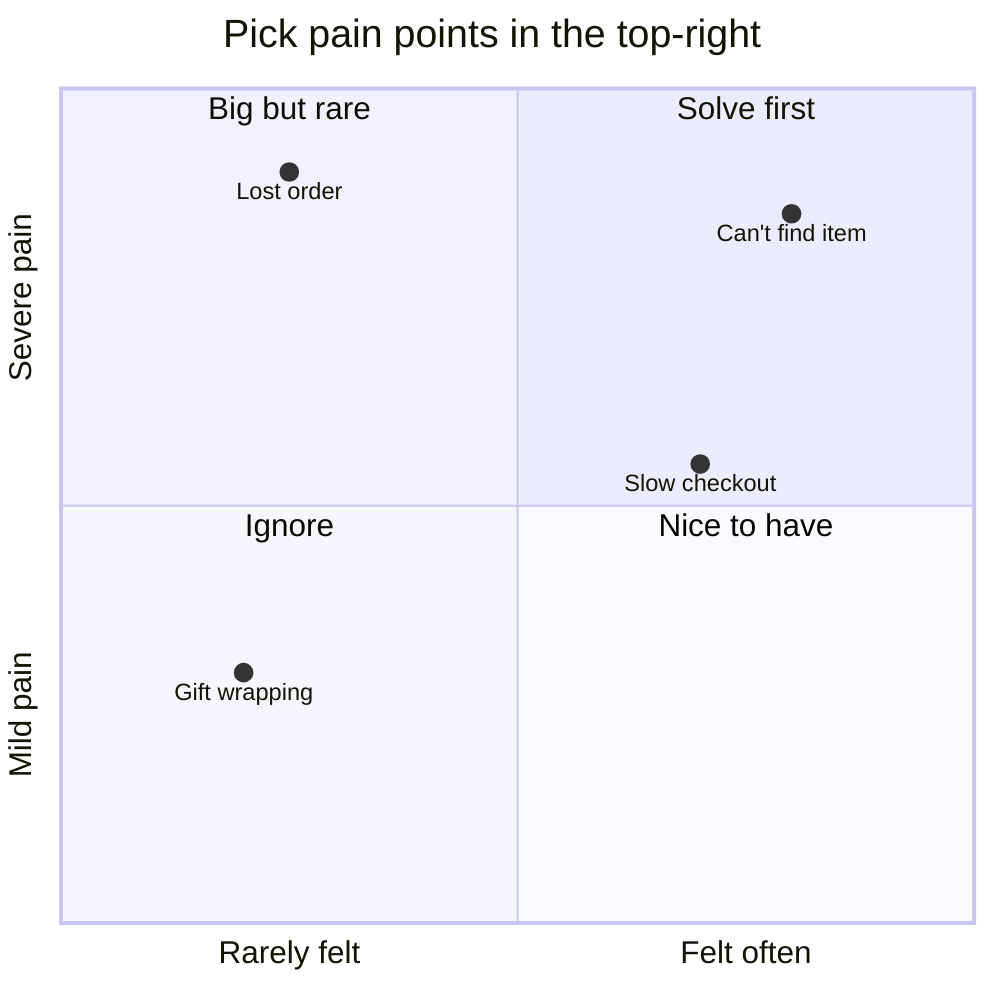

# 🎨 CIRCLES: the product design framework

**Use it for:** "Design a ___ for ___" and "Build a product that ___" questions.
**Goal:** show you can go from a vague prompt to a user-centred, prioritized solution, *out loud*, in about 20 minutes.

<FrameworkSteps steps={[
  {letter: 'C', title: 'Comprehend', desc: 'Clarify the prompt. Who is it for, what is the goal, and what are the constraints?', ask: ['What is the goal: growth, engagement, revenue, or a mission?', 'Is this a new product or part of an existing company?', 'Any constraints on platform, timeline or region?']},
  {letter: 'I', title: 'Identify users', desc: 'List user segments, then pick ONE to focus on, with a reason.', ask: ['Who are all the possible users? Segment by need or behaviour, not demographics alone.', 'Which segment is the biggest, most underserved, or best aligned with the goal?']},
  {letter: 'R', title: 'Report needs', desc: 'Walk through the chosen user’s journey and list their pain points and needs.', ask: ['What are they trying to get done (the job to be done)?', 'Where in the journey does it hurt most?']},
  {letter: 'C', title: 'Cut (prioritize)', desc: 'Prioritize the needs by impact versus how well they are currently served. Pick 1–2.', ask: ['Which pain point is frequent, severe and poorly solved today?']},
  {letter: 'L', title: 'List solutions', desc: 'Brainstorm 3+ distinct solutions. Include one bold one.', ask: ['A low-tech option, a software option, and a "moonshot" option?']},
  {letter: 'E', title: 'Evaluate trade-offs', desc: 'Compare the solutions on impact, effort, risk and fit with the goal.', ask: ['What are the cost, risk and dependencies of each?']},
  {letter: 'S', title: 'Summarize', desc: 'Recommend one solution, give an MVP scope, a success metric and next steps.', ask: ['What would v1 be?', 'How will we measure success?', 'What is the riskiest assumption to test first?']},
]} />

## 🗺️ The whole flow on one page

## ⏱️ Time budget (about 20 minutes)

## 📐 Prioritizing needs: a quick visual

## ✅ Signals interviewers look for

<IconCards items={[
  {icon: '🎯', title: 'Goal first', text: 'You tied every choice back to a stated goal.'},
  {icon: '👥', title: 'Sharp segment', text: 'You picked ONE user group and said why.'},
  {icon: '💥', title: 'Real pain', text: 'Your needs are specific and come from the user journey.'},
  {icon: '🌈', title: 'Creative range', text: 'At least one non-obvious solution.'},
  {icon: '⚖️', title: 'Trade-offs', text: 'You compared options openly instead of just picking a favourite.'},
  {icon: '📏', title: 'Measurable', text: 'You ended with a success metric and an MVP.'},
]} />

:::warning Common mistakes
- Jumping to solutions in the first minute.
- Designing for "everyone".
- Listing ten features without prioritizing them.
- Forgetting to say how you'd measure success.
:::

<Quiz question="An interviewer says “Design an app for gardeners.” What should you do FIRST?" options={["Sketch the home screen", "Ask about the goal and constraints, then segment gardeners", "List 10 features", "Pick a monetization model"]} answer={1} explain="Comprehend comes first. The goal and constraints shape which user segment and which needs matter." />

<UsedBy framework="circles" />
