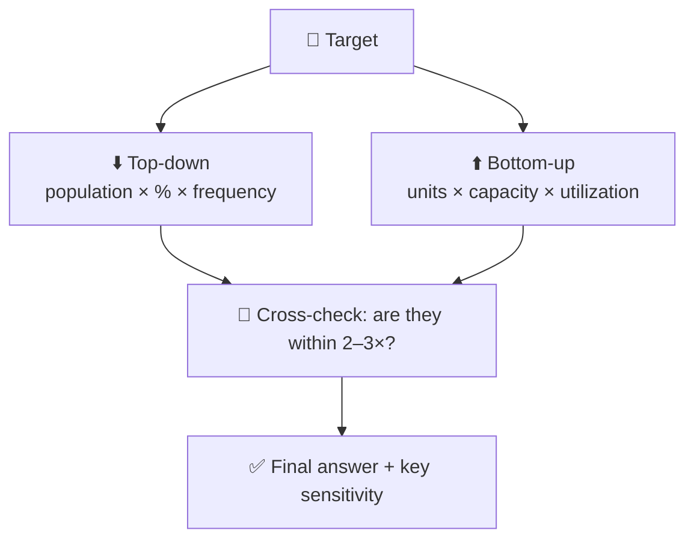

# 🧮 Estimation (guesstimate) framework

The interviewer doesn't care about the exact number. They care that your **structure is logical, your assumptions are stated, and you sanity-check the result**.

<FrameworkSteps steps={[
  {letter: '1', title: 'Clarify', desc: 'What exactly is being counted? Which geography, time period and units (revenue or units sold)?'},
  {letter: '2', title: 'Choose approach', desc: 'Top-down (population → filters) or bottom-up (per store or per user → total). Say which and why.'},
  {letter: '3', title: 'Build the tree', desc: 'Write out the formula as a tree before you plug in numbers.'},
  {letter: '4', title: 'Assume', desc: 'Use round, defensible numbers and say them out loud.'},
  {letter: '5', title: 'Calculate', desc: 'Do the maths step by step and round aggressively.'},
  {letter: '6', title: 'Sanity check', desc: 'Compare with a known anchor, or cross-check with the other approach.'},
]} />

## Try it: how many coffee cups are sold daily in a city of 10M?

<EstimationCalc
  inputs={[
    {key: 'pop', label: 'Population', value: 10000000},
    {key: 'adult', label: 'Share of adults', value: 0.75},
    {key: 'drinkers', label: 'Share of adults who drink coffee', value: 0.6},
    {key: 'cups', label: 'Cups per drinker per day', value: 1.5, unit: 'cups'},
    {key: 'bought', label: 'Share of cups bought (not made at home)', value: 0.3},
  ]}
  steps={[
    {key: 'a', label: 'Adults', expr: 'pop * adult'},
    {key: 'd', label: 'Coffee drinkers', expr: 'a * drinkers'},
    {key: 'c', label: 'Cups consumed per day', expr: 'd * cups'},
    {key: 'b', label: '☕ Cups bought per day', expr: 'c * bought'},
  ]}
/>

## Handy anchors to memorize

| Anchor | Approximate value |
|---|---|
| World population | 8 B |
| USA / India / China population | 335 M / 1.43 B / 1.41 B |
| US households | ~130 M (≈2.5 people each) |
| Smartphone users worldwide | ~4.5–5 B |
| Seconds in a day | 86,400 (≈ 10⁵) |
| Days per year / working days | 365 / ~250 |
| Average lifespan | ~75 years (useful for "replaced every N years" calculations) |

:::tip Pro move
At the end, say which assumption the answer is **most sensitive to**, and how you'd validate it with real data.
:::

<UsedBy framework="estimation" />
