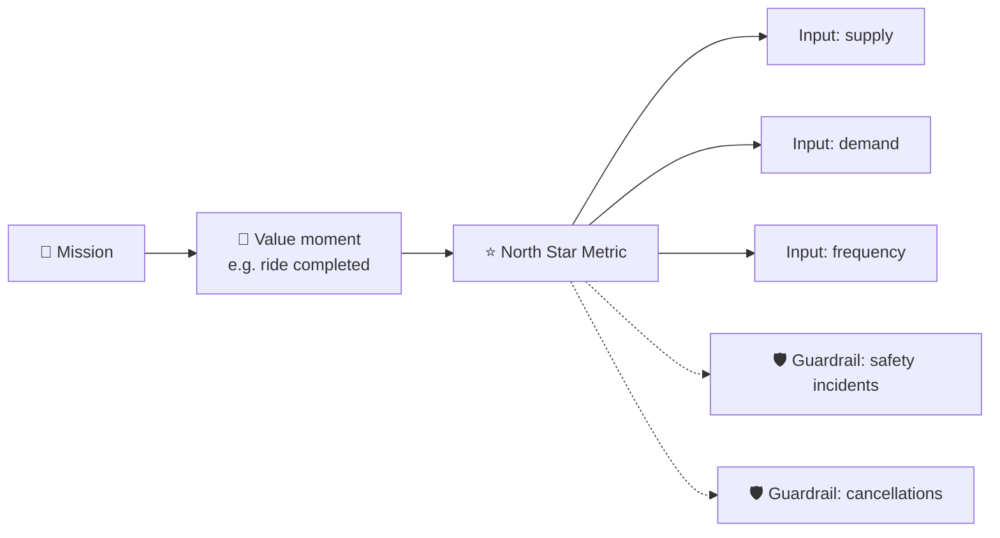

# 📊 Metrics framework: "How would you measure success of ___?"

<FrameworkSteps steps={[
  {letter: '1', title: 'Clarify', desc: 'What is the product or feature, and what stage is it at (new launch or mature)?'},
  {letter: '2', title: 'Goal / mission', desc: 'Why does it exist? What value does it give users, and what does it give the business?'},
  {letter: '3', title: 'User actions', desc: 'Map the user journey: what do users DO when they get value?'},
  {letter: '4', title: 'Metric menu', desc: 'List metrics for each funnel stage: acquisition, activation, engagement, retention and monetization.'},
  {letter: '5', title: 'North Star', desc: 'Pick ONE metric that best captures delivered value. Justify it.'},
  {letter: '6', title: 'Guardrails', desc: 'Add 2–3 metrics that must NOT get worse, such as quality, trust or cost.'},
  {letter: '7', title: 'Trade-offs', desc: 'Discuss how the metric could be gamed and what it misses.'},
]} />

## The funnel menu (AARRR)

<MetricTree tree={{label: 'Product health', children: [
  {label: 'Acquisition', note: 'new sign-ups, CAC, channel mix'},
  {label: 'Activation', note: '% reaching the aha moment in first session/week'},
  {label: 'Engagement', note: 'DAU/MAU, actions per user, time on key task'},
  {label: 'Retention', note: 'D1/D7/D30, cohort curves, churn'},
  {label: 'Revenue', note: 'ARPU, conversion to paid, LTV'},
  {label: 'Referral', note: 'invites sent, viral coefficient k'},
]}} />

## HEART: for UX-heavy features

| Letter | Means | Example for a "search" feature |
|---|---|---|
| H | Happiness | CSAT after search |
| E | Engagement | searches per user per week |
| A | Adoption | % of users who used search this week |
| R | Retention | % still searching after 4 weeks |
| T | Task success | % of searches ending in a click within 30s |

:::warning Common mistakes
- Picking a vanity metric (like downloads) as your North Star.
- No guardrails, so a team could hit the number while hurting users.
- Listing 15 metrics without saying which one matters most.
:::

<Quiz question="Which is the best North Star for a food delivery app?" options={["App downloads", "Orders delivered on time per week", "Number of restaurants", "Push notification CTR"]} answer={1} explain="It captures value to the customer, the restaurant and the courier at the same time, and it grows with frequency." />

<UsedBy framework="metrics" />
