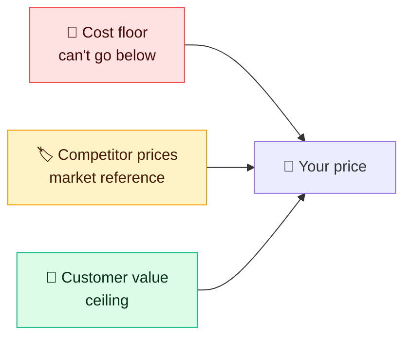

# 💰 Pricing & monetization framework

<FrameworkSteps steps={[
  {letter: '1', title: 'Objective', desc: 'Are you maximizing revenue, market share, or adoption? Or entering a new segment?'},
  {letter: '2', title: 'Customer & value', desc: 'Who pays? What is it worth to them, and what is their next-best alternative?'},
  {letter: '3', title: 'Costs', desc: 'Marginal cost per user, fixed costs, and the price floor.'},
  {letter: '4', title: 'Competition', desc: 'Competitor prices and positioning, and the substitutes.'},
  {letter: '5', title: 'Model', desc: 'Subscription, usage-based, freemium, tiered, ads, transaction fee, or per seat.'},
  {letter: '6', title: 'Price points', desc: 'Value-based range, tiers, anchoring and discounts.'},
  {letter: '7', title: 'Test & measure', desc: 'Price tests, conversion, ARPU, churn and LTV/CAC.'},
]} />

**Rule of thumb:** price between the cost floor and the value ceiling, and use competitors as a reference point. Value-based pricing captures the most revenue.

<UsedBy framework="pricing" />
