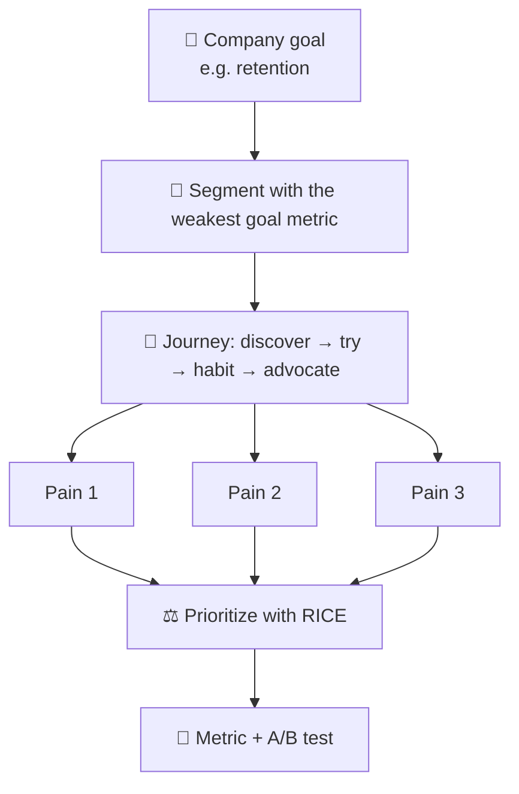
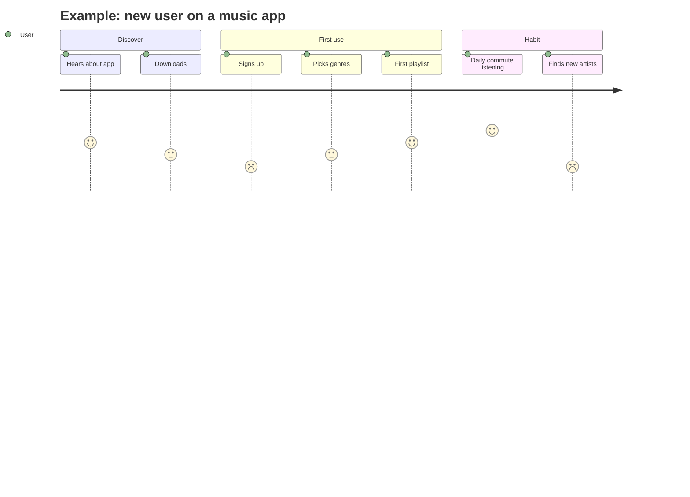

# 🛠️ Product improvement framework

**Use it for:** "How would you improve ___?" and "What's your favourite product, and how would you make it better?"
The difference from product design: the product **already exists**. You need to show you understand *why it works* before you change it.

<FrameworkSteps steps={[
  {letter: '1', title: 'Clarify & goal', desc: 'Which part of the product, which platform, and what does the company want right now: acquisition, engagement, retention or monetization?'},
  {letter: '2', title: 'Understand product', desc: 'Explain in one sentence what the product is, who uses it, its core value, and how it makes money.'},
  {letter: '3', title: 'Users & segments', desc: 'Segment the users and pick one segment where the improvement goal is weakest.'},
  {letter: '4', title: 'Pain points', desc: 'Walk the journey for that segment and list the friction points.'},
  {letter: '5', title: 'Ideas', desc: 'Come up with 3 improvements, ranging from incremental to bold.'},
  {letter: '6', title: 'Prioritize', desc: 'Rank them by impact on the goal, effort and risk (RICE works well here). Pick one.'},
  {letter: '7', title: 'Metrics & risks', desc: 'Give the success metric, guardrail metrics, and how you would test it (an A/B test).'},
]} />

## The user journey lens

Low scores mean friction, and friction is where the improvement opportunities are.

:::tip Pro move
Name what the product does *well* before you criticize it. It shows respect for past decisions and makes it clear you understand the trade-offs that were made.
:::

<Quiz question="You're asked to improve Instagram. Which goal framing is strongest?" options={["Make it better for everyone", "Increase 7-day retention of new creators who have posted fewer than 3 times", "Add more features", "Redesign the logo"]} answer={1} explain="This is specific, measurable and focused on one segment. You can design and test against it." />

<UsedBy framework="product-improvement" />
