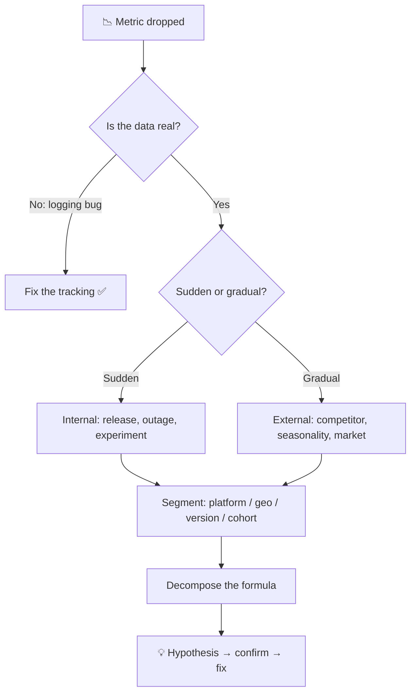
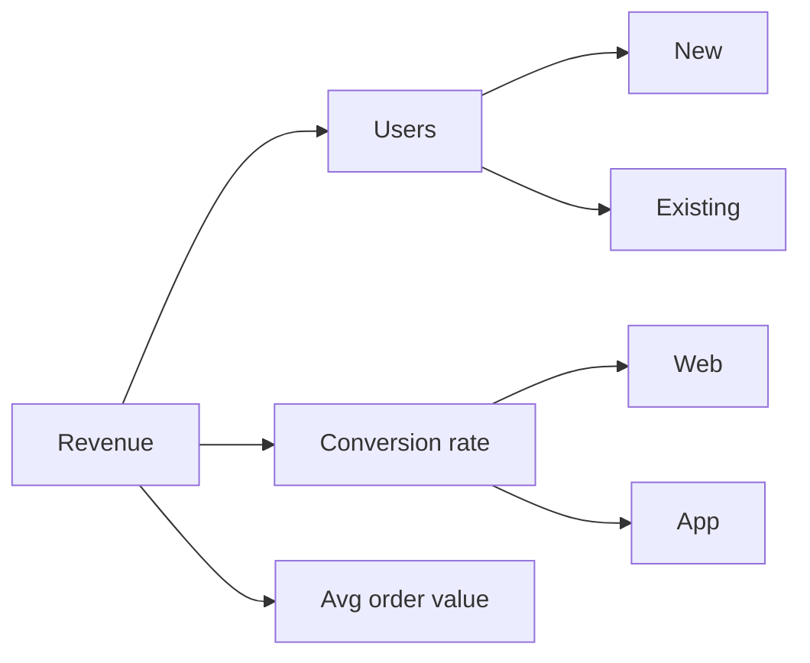

# 🔍 Root cause analysis: "Metric X dropped 10%. What happened?"

These questions test calm, structured debugging. A good answer **narrows the problem down systematically** instead of guessing.

<FrameworkSteps steps={[
  {letter: '1', title: 'Clarify metric', desc: 'How exactly is it defined? Is it a count or a rate? Over what time window, compared to what baseline?'},
  {letter: '2', title: 'Validate data', desc: 'Is the drop real? Check for logging or tracking changes, dashboard bugs, or a definition change.'},
  {letter: '3', title: 'Timing', desc: 'Sudden or gradual? One-off or recurring? Seasonal? Find the exact start date.'},
  {letter: '4', title: 'Internal changes', desc: 'Releases, experiments, pricing changes, outages, or marketing that stopped.'},
  {letter: '5', title: 'External factors', desc: 'Competitors, news, holidays, regulation, OS or app store changes.'},
  {letter: '6', title: 'Segment', desc: 'Slice by platform, geography, app version, new vs existing users, and channel. Where is the drop concentrated?'},
  {letter: '7', title: 'Decompose', desc: 'Break the metric into its formula (for example, users × rate) and see which factor moved.'},
  {letter: '8', title: 'Hypothesis & fix', desc: 'State the most likely cause, how you would confirm it, and what you would do.'},
]} />

## The decomposition trick

Once you have the formula, ask: *which branch moved?* That alone usually halves the search space.

:::tip The magic question
"Is this drop happening **across all segments evenly**, or is it **concentrated** in one?" An even drop points to something external or global. A concentrated drop points to a bug or change in that segment.
:::

<Quiz question="DAU dropped 8% overnight, only on Android, only for app version 5.2. What's most likely?" options={["A competitor launched", "Seasonality", "A bug or crash in the 5.2 Android release", "The market is shrinking"]} answer={2} explain="A sudden drop concentrated in one platform and version strongly suggests an internal release issue." />

<UsedBy framework="root-cause" />
