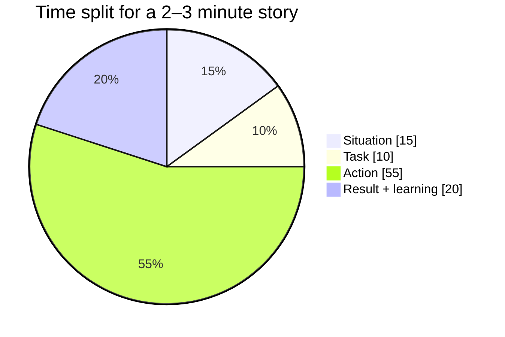
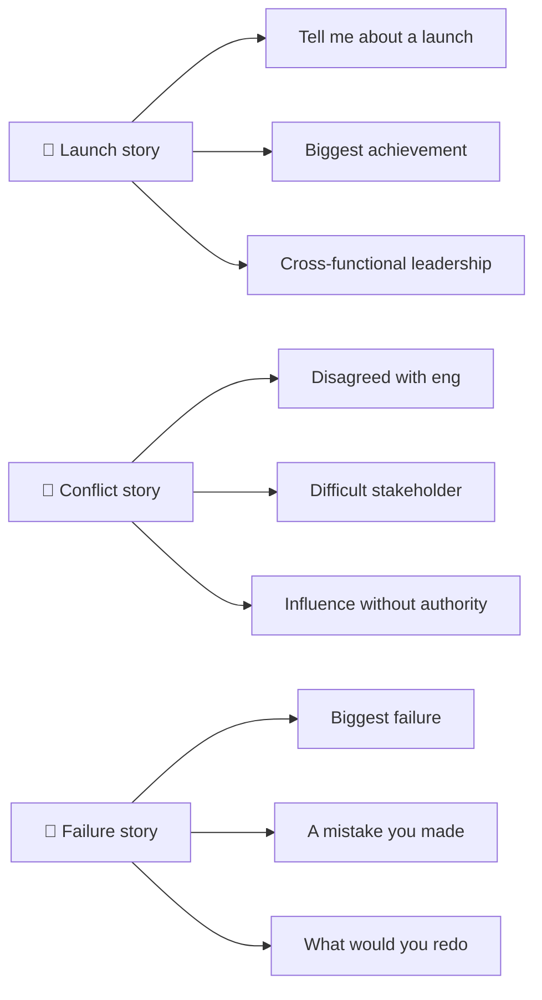

# 🤝 STAR: behavioral answers that land

<FrameworkSteps steps={[
  {letter: 'S', title: 'Situation', desc: 'Give the context in 2–3 sentences: company, team, and the stakes.'},
  {letter: 'T', title: 'Task', desc: 'What was YOUR responsibility or goal? Why was it hard?'},
  {letter: 'A', title: 'Action', desc: 'What you specifically did, step by step. Say "I", not "we". Spend about 60% of your time here.'},
  {letter: 'R', title: 'Result', desc: 'The outcome, with numbers if possible, plus what you learned and would do differently.'},
]} />

## Build a story bank once, reuse it everywhere

Prepare 6–8 stories. Each one can answer many questions:

| Story theme | Answers questions about… |
|---|---|
| A launch you led | ownership, execution, cross-functional leadership |
| A conflict with engineering or design | conflict, influence, communication |
| A failure or bad call | failure, learning, humility |
| A decision made with data | analytical thinking, metrics |
| A time you said no | prioritization, stakeholder management |
| A time you changed someone's mind | influence without authority |
| Ambiguity: no clear direction | dealing with ambiguity, strategy |
| Helping a teammate grow | leadership, mentorship |

:::warning Common mistakes
- Spending 2 minutes on context.
- Saying "we" so much that your own role disappears.
- Failure stories that aren't really failures ("I worked too hard").
- No result, or no lesson learned.
:::

<UsedBy framework="star" />
