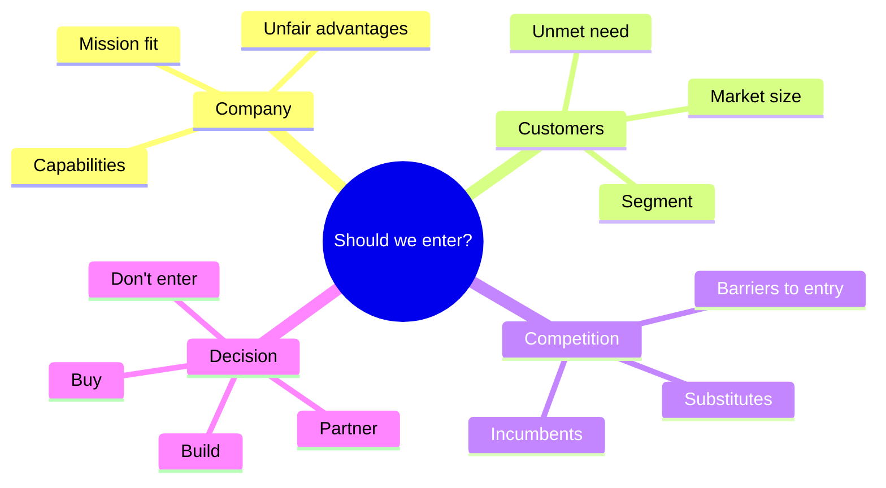
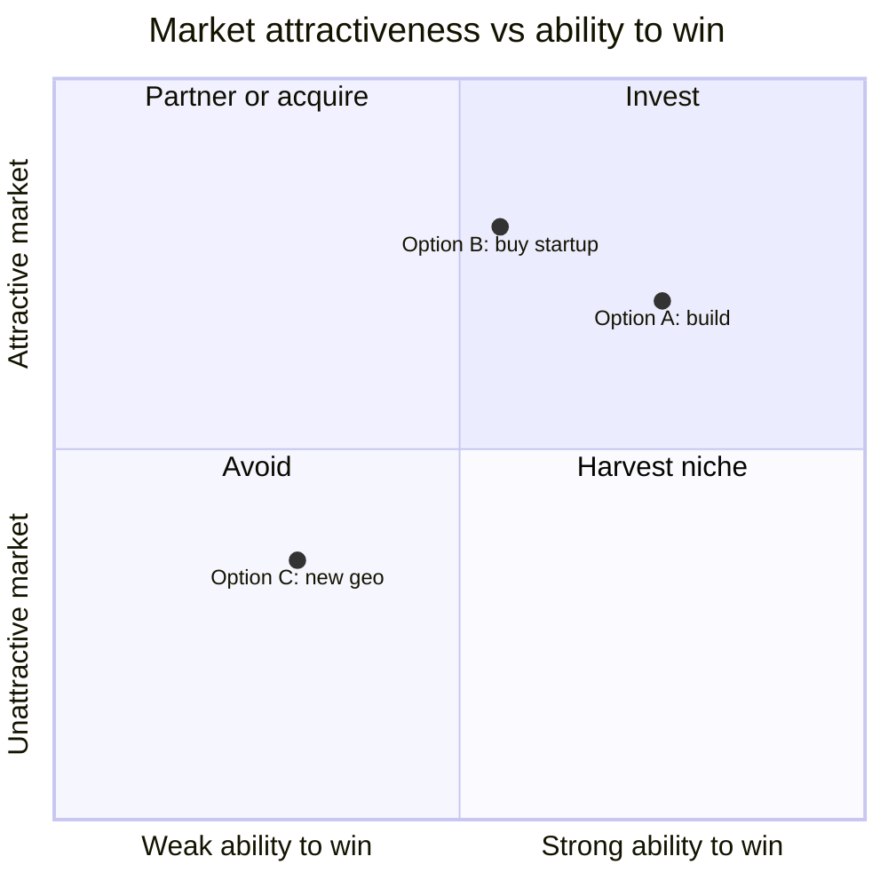

# ♟️ Product strategy framework

**Use it for:** "Should Company X enter market Y?", "How should X respond to competitor Z?", "Build, buy or partner?", "What should X do in 5 years?"

<FrameworkSteps steps={[
  {letter: '1', title: 'Clarify objective', desc: 'Is the aim growth, defence, a new revenue line, or the mission? What time horizon?'},
  {letter: '2', title: 'Company (3C · 1)', desc: 'Mission, strengths, assets, and what it is uniquely good at.'},
  {letter: '3', title: 'Customers (3C · 2)', desc: 'Which segment, what unmet need, and how big is it (TAM)?'},
  {letter: '4', title: 'Competition (3C · 3)', desc: 'Who serves this need today, and where are they weak? Porter’s forces.'},
  {letter: '5', title: 'Options', desc: 'List 2–4 strategic options, such as build, buy, partner, or don’t enter.'},
  {letter: '6', title: 'Evaluate', desc: 'Score each on market attractiveness, ability to win, cost, risk and fit.'},
  {letter: '7', title: 'Recommend', desc: 'Make a clear call, give the first 3 steps, the key risks, and the metric for success.'},
]} />

## Evaluating options visually

:::tip Always make a call
Strategy interviews punish fence-sitting. Saying "it depends" is fine as a *start*, but finish with: "Given X and Y, I'd recommend **Z**, and I'd validate it by ___."
:::

<UsedBy framework="strategy" />
