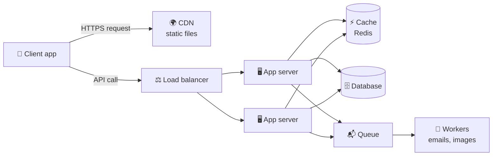
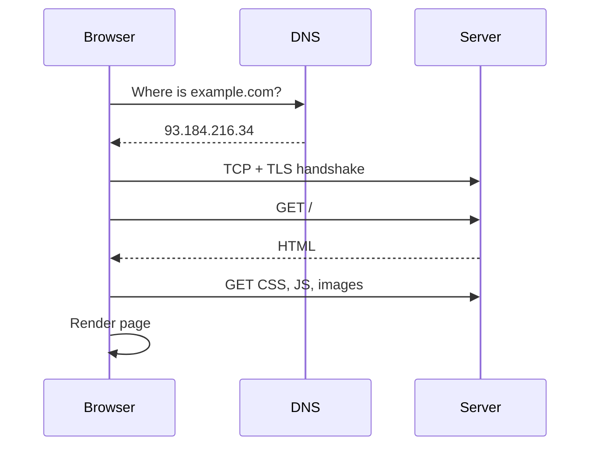

# ⚙️ Technical questions for PMs

You're not expected to code. You **are** expected to explain how systems work at a high level, reason about trade-offs, and talk credibly with engineers.

<FrameworkSteps steps={[
  {letter: '1', title: 'Clarify scope', desc: 'Which part of the system, at what scale, and for which users?'},
  {letter: '2', title: 'User flow', desc: 'Describe what the user does, step by step.'},
  {letter: '3', title: 'Components', desc: 'Client, API, services, database, cache, queues and third parties.'},
  {letter: '4', title: 'Data flow', desc: 'What data moves where, and when? Draw it.'},
  {letter: '5', title: 'Trade-offs', desc: 'Latency vs consistency, cost vs scale, build vs buy.'},
  {letter: '6', title: 'Failure modes', desc: 'What breaks at 10× traffic? What happens if a service goes down?'},
]} />

## The universal web app diagram

## What happens when you type a URL

:::tip Speak in trade-offs
"We could cache this to cut latency from 300ms to 20ms, but users might see data up to 60 seconds stale. For a news feed that's fine. For a bank balance it isn't."
:::

<UsedBy framework="technical" />
