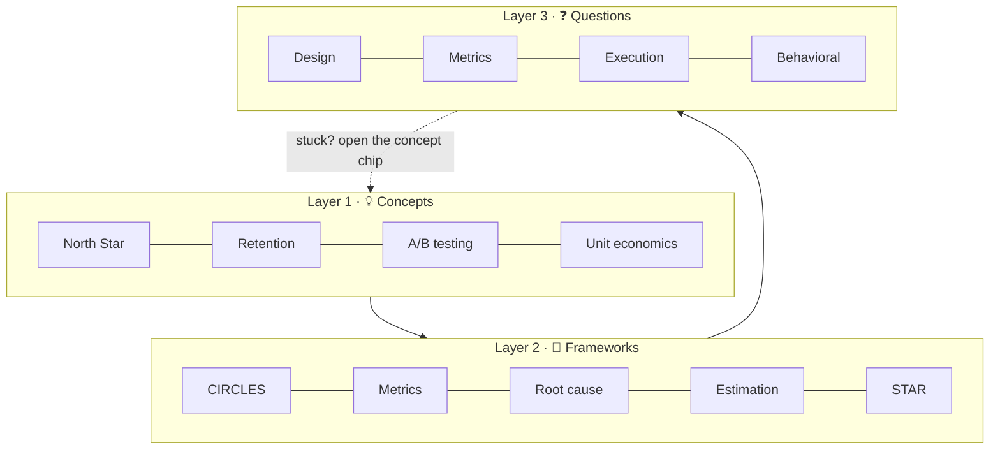
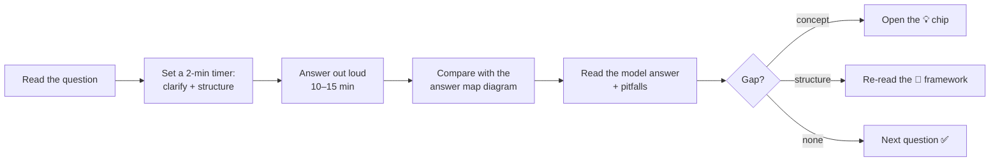

# 🗺️ Start here: how to use this book

This book has **three layers**. Learn them in this order and loop back whenever a question exposes a gap.



<IconCards items={[
  {icon: '💡', title: 'Concepts', text: 'Short, focused chapters on one idea each, like retention or network effects. Every chapter lists the questions that use it.', color: '#8b5cf6'},
  {icon: '🧭', title: 'Frameworks', text: 'Repeatable answer structures for each interview type. Click through the steps interactively.', color: '#ec4899'},
  {icon: '❓', title: 'Questions', text: 'Practice questions with difficulty, ★ learning value, an answer-map diagram and a model answer.', color: '#10b981'},
  {icon: '🔎', title: 'Question Finder', text: 'Filter by category, difficulty, rating, company and concept. Bookmark your filtered view.', color: '#f59e0b'},
]} />

## ⭐ What the ratings mean

| Rating | Meaning |
|---|---|
| <Stars value={5} /> | **Must practise.** A canonical question that builds a reusable skill. If you only have one week, do all 5★ questions. |
| <Stars value={4} /> | High value. A strong variation that adds a new angle. |
| <Stars value={3} /> | Good practice. Solid, but overlaps with higher-rated ones. |
| <Stars value={2} /> | Niche or repetitive. Do it once you're comfortable. |
| <Stars value={1} /> | Trivia or warm-up. |

**Difficulty** (<Difficulty value="Easy" /> <Difficulty value="Medium" /> <Difficulty value="Hard" />) is how hard it is to give a *great* answer, not just an okay one.

## 📅 A 4-week study plan

```mermaid
gantt
  dateFormat  X
  axisFormat  W%s
  section Week 1
  Concepts: metrics, users, prioritization :a1, 0, 7
  Frameworks: CIRCLES and Metrics        :a2, 0, 7
  section Week 2
  Product Design + Improvement 5★        :b1, 7, 14
  Metrics 5★                             :b2, 7, 14
  section Week 3
  Execution / Root cause                 :c1, 14, 21
  Estimation + Strategy                  :c2, 14, 21
  section Week 4
  Behavioral stories (STAR)              :d1, 21, 28
  Technical + AI + mock interviews       :d2, 21, 28
```

## 🎙️ How to practise one question



:::tip
Speak your answers out loud, or record them. Interviews are a *spoken* skill, and reading model answers alone gives you false confidence.
:::
